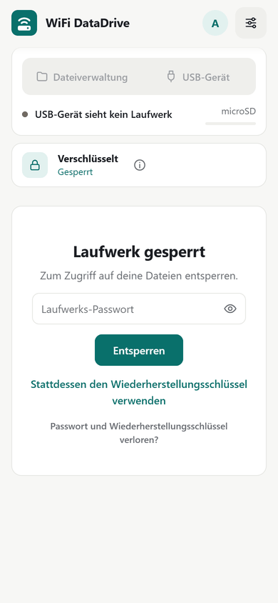
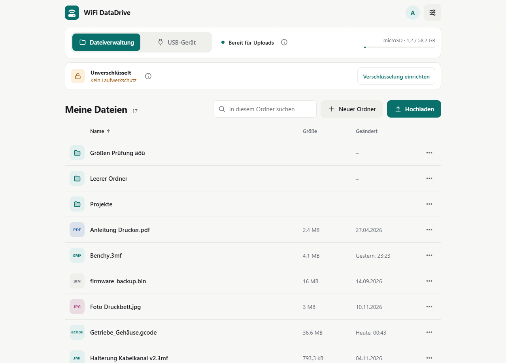
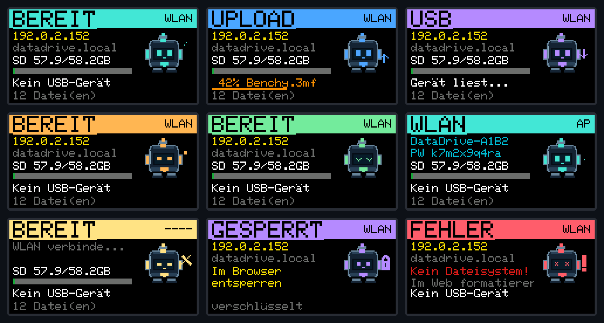
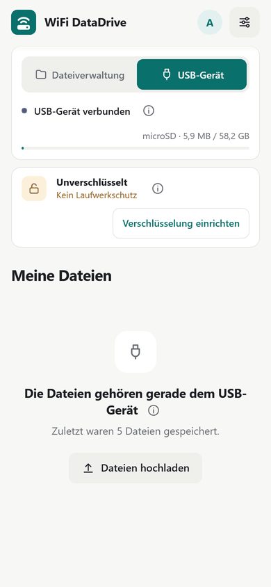
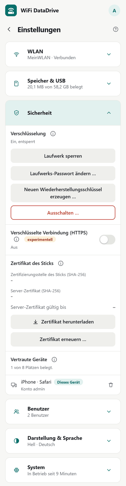

<p align="center">
  
</p>

<h1 align="center">WiFi DataDrive</h1>

<p align="center">
  <strong>WiFi DataDrive turns a LILYGO T-Dongle-S3 into a USB stick with Wi-Fi.</strong><br>
  The device it is plugged into sees a normal drive. You manage the files on it from a browser or as a
  network drive, without unplugging the stick.
</p>

<p align="center">
  
  
  
  
  
  <a href="LICENSE"></a>
  
</p>

<p align="center">
  <a href="https://wliffers.github.io/wifi-datadrive/"></a>
  <a href="../../releases/latest"></a>
  <a href="https://www.linkedin.com/in/willi-liffers-71660b319/"></a>
</p>

<p align="center">
  <a href="https://buymeacoffee.com/wliffers"></a>
</p>

<p align="center">
  <a href="#features">Features</a> ·
  <a href="#use-cases">Use cases</a> ·
  <a href="#installation">Installation</a> ·
  <a href="#first-setup">Setup</a> ·
  <a href="#using-it-with-a-usb-host">With a USB host</a> ·
  <a href="#setting-up-and-using-encryption">Encryption</a> ·
  <a href="#network-drive-and-https">Network drive &amp; HTTPS</a> ·
  <a href="#tested-and-untested">Test status</a> ·
  <a href="#limitations">Limitations</a> ·
  <a href="#liability-and-licence">Liability &amp; licence</a> ·
  <a href="README.md">Deutsch</a>
</p>

---

<p align="center">
  
</p>
<p align="center"><sub>On a phone: unlock, browse files, upload, settings. Recorded against the mock server with sample files,
German interface; the interface also comes in English.</sub></p>

The dongle plugs into a device with a USB port and shows up there as a normal USB drive. Over Wi-Fi you
open a built-in file manager in your browser. There you upload and download files, rename, move and delete
them, without unplugging the stick. The same files are also reachable as a network drive, and if you want,
the stick encrypts the memory card.

The USB hosts tested are a Windows PC and a 3D printer: the Bambu Lab X2D recognised the stick and printed
from it, also encrypted. The project started out for this printer; today it is one use case. Other
devices are possible but untested, see [Use cases](#use-cases).

The web interface comes in German and English and works on phones and PCs. It needs no internet
connection and no app.

> **Private project.** WiFi DataDrive is a spare-time project with no affiliation to LILYGO, Espressif or
> Bambu Lab. The software is provided without warranty and without liability. Details are in the
> [disclaimer](HAFTUNGSAUSSCHLUSS.md) (German and English).

> **Status 2026-11-14.** The source carries version 0.6.0, the first release. It runs on the device:
> installed by an update in the browser and with the web flasher, tested with the API test (415/415) and
> with signed updates. Also tried on the device: a static IP address with your own name, the lock after the
> timeout and printing from an encrypted stick. What exactly is tested and what is not is listed under
> [Tested and untested](#tested-and-untested).

## Features

**One stick, two ways in.**
At the USB host the dongle is an ordinary USB drive. Over Wi-Fi you manage the same files in a browser.

**Only one side at a time.**
At any moment the drive belongs either to the USB host or to the file manager in the browser. The stick
switches in a controlled way and asks first if the USB host is still using the drive.

**Files and folders.**
Upload with a button or by drag and drop, any file type, up to 4 GB per file. Create, rename, move, copy
and delete folders, also several files at once. Folders download as ZIP. An interrupted upload resumes
where it stopped.

**Login with roles.**
Up to 8 users with the roles `admin` and `user`. Devices you trust stay signed in.

**Encryption if you want it.**
AES-256-XTS on the memory card, off by default. After each plug-in you unlock the drive in the browser.
If you like, it locks itself after a time without access while the file manager has the drive; from
0.6.0 the interface shows the remaining time.

**Several Wi-Fi networks.**
Up to 5 networks; the stick connects to the strongest. When you add one, it lists the networks in range.
From 0.6.0 there is a static IP address and your own network name (`name.local`).

**Network drive and HTTPS.**
The stick is also reachable as a network drive (WebDAV). An encrypted connection (HTTPS) can be switched on.

**Time from the network.**
Files get a correct date. The time zone can be chosen.

**Display and button.**
The LCD shows address, state and storage, plus the mascot LIO. One click on the button shows the address
as a QR code.

**Updates in the browser.**
You install new firmware through the web interface. If it does not start cleanly, the stick returns to the
previous version. From 0.6.0 the firmware can be built to accept signed updates only.

**Help on the device.**
The i icons and the page "Hilfe & Anleitungen" (help and guides) explain every setting, also without
internet.

<p align="center">
  
</p>

### The display

The small colour display shows at a glance what the stick is doing. The state is at the top in a coloured
bar, the Wi-Fi tag at the top right. Below are the address for the browser, the storage and what the USB
host is doing. On the right, the mascot LIO shows the state as a small animation. The bar and the LED on
the stick take LIO's colour.

<p align="center">
  
</p>

| Bar | LIO | Meaning |
|---|---|---|
| **BEREIT** (ready) turquoise | calm | The file manager has the drive; you can upload in the browser. |
| **UPLOAD** blue | arrow up | An upload is running; progress and file name below. |
| **USB** purple | arrow down | The drive is provided to the USB host and it is reading or writing. When the host is idle, LIO shows "ready" again. |
| **BEREIT** orange | working | Copying, formatting or an update is running. |
| **BEREIT** green | tick | The drive was just unlocked (once, then back to the normal state). |
| **WLAN** turquoise, "AP" at the top | radio waves | The stick's setup Wi-Fi is on. Name and password are shown; the QR code (press the button once) joins the phone directly. |
| **BEREIT** yellow, "----" at the top | crossed out | No Wi-Fi; the stick is looking for its saved networks. |
| **GESPERRT** (locked) purple | padlock | The encrypted drive is locked. Unlock it in the browser with the drive password; until then the USB host sees no drive. |
| **FEHLER** (error) red | warning sign | For example a card without a file system (format it in the browser) or a damaged key area. |

The bottom line shows the number of files, "verschlüsselt" (encrypted) when locked. The texts follow the
language of the web interface (German or English). The picture is rendered from the firmware's data
(font, colours, animation; `tools/render_display.py`), not a photo; the addresses are examples.
LIO is the author's mascot and is not covered by the MIT licence, see [LICENSE-LIO.md](LICENSE-LIO.md).

## Use cases

Wherever a device reads files from a USB stick, WiFi DataDrive saves you the trip to the device: the files
reach the stick over Wi-Fi, and the stick stays plugged in.

**Tested: 3D printer (Bambu Lab X2D).** The sliced file, for example a `.gcode.3mf`, goes from a PC or
phone to the stick through the browser. The printer shows it and prints it. Tested without encryption
(firmware 0.2.0 and 0.3.0) and with an encrypted stick unlocked by phone (0.6.0). The steps are under
[Using it with a USB host](#using-it-with-a-usb-host).

**Tested: Windows PC.** On Windows 11 the stick is a normal drive: copy, eject, re-plug.

**Possible, but untested:** other 3D printers, laser engravers and CNC controllers, paper printers with a
USB port for sticks, TVs and media players, car radios, embroidery machines, computers running macOS or
Linux. There is no claim for any of these. The stick presents itself as an ordinary USB mass-storage device
at Full Speed (12 Mbit/s), with FAT32 on the microSD card. Only a try shows whether a device copes with
that. Keep in mind as well: while you work in the browser, the drive is as good as unplugged for the
device. How a device reacts to that is untested too. Results with other devices are welcome as
[feedback](#feedback).

## What you need

- **LILYGO T-Dongle-S3 with LCD** (ESP32-S3, 16 MB flash, microSD slot, one button). Only this variant is
  built and tested. T-Dongle-S3 Plus and Dual are not tested.
- **A microSD card**, FAT32 recommended. A 64 GB card is tested. Without a card the stick uses its internal
  flash: about 11 MB, writing at about 46 KB/s.
- **A 2.4 GHz Wi-Fi network.** The ESP32-S3 cannot do 5 GHz.
- **A device that reads USB sticks**, with a USB-A port. Tested are a PC with Windows 11 and the Bambu Lab
  X2D, see [Use cases](#use-cases).
- **Chrome or Edge** on a PC or Mac if you want to flash in the browser.

## Installation

**Requirement:** Chrome or Edge on a PC or Mac and a USB-A port for the dongle.

1. Open the [web flasher](https://wliffers.github.io/wifi-datadrive/).
2. Hold the button on the dongle, plug it in and release the button after about 2 seconds. The dongle is
   now in download mode.
3. Click **Install** and choose the dongle's port. On the first installation answer "Erase device" with yes.
4. Unplug the dongle once after flashing and plug it back in.

The full image resets users, saved Wi-Fi networks and settings. The microSD card is not written. The
flasher page is tested with a real dongle (0.6.0).

Without a browser, use esptool:
`python -m esptool --chip esp32s3 write_flash 0x0 wifi-datadrive-vX.Y.Z-esp32s3-merged.bin`

<details>
<summary>Building it yourself with ESP-IDF</summary>

You need **ESP-IDF 5.5.6** (exactly this version; the components are pinned in
`firmware/printdrive/dependencies.lock`).

```sh
idf.py -C firmware/printdrive build
idf.py -C firmware/printdrive -p PORT flash
```

On Windows the scripts in `tools/` load the ESP-IDF environment themselves:

```powershell
.\tools\flash.ps1 -Project printdrive -Build -Monitor
```

`flash.ps1` finds the port and sends a running stick into download mode by software. If that fails, hold
the button while plugging in and unplug the dongle once after flashing. Run only one build at a time.

You can build in your own Wi-Fi credentials: copy `firmware/pd_secrets.h.example` to
`firmware/pd_secrets.h` (git-ignored). Never pass on binaries built that way.

Installing ESP-IDF, restoring the factory firmware and all options:
[docs/04_build_und_flash.md](docs/04_build_und_flash.md) (German).
</details>

## First setup

1. Without a saved Wi-Fi network the stick opens its own network `DataDrive-XXXX`. The password is on the
   display. Connect your phone to it.
2. The setup page should open by itself (**untested** with a real phone). Otherwise enter
   `http://192.168.4.1` in the browser. The phone's sign-in window only handles the Wi-Fi setup. For files,
   close it (iPhone: "Use Without Internet") and use the browser.
3. Sign in with `admin` / `admin`. The interface asks for a new password right away; nothing else works
   before that.
4. Add your Wi-Fi under **Settings › WLAN**. Afterwards the stick is reachable at `http://datadrive.local`
   or at the address on the display.

**Forgot the address?** One click on the button shows it as a QR code for 20 seconds. Point your phone at
it and open the link.

**Forgot the password?** Hold the button for 10 seconds. The users go back to `admin` / `admin`, from 0.6.0
the network settings as well. Your files stay, and an encrypted drive stays locked.

The button behaviour follows the source code and is **untested** on the device. All button functions are
listed in [docs/09_api_v3.md](docs/09_api_v3.md) section 9 (German).

## Using it with a USB host

The drive always has exactly one owner: the USB host the stick is plugged into, or the file manager in the
browser. While you work in the browser, the USB host sees no drive; once you hand it back, it sees the new
files.

1. Plug the stick into the device's USB port. At the top of the interface **USB-Gerät** (USB device) is
   selected.
2. Upload your files in the browser. The interface takes the drive for this, asks first if the device is
   still using it, and hands it back after the upload.
3. Open the file on the device.

<p align="center">
  
</p>

**Do not switch while the device is reading.** "Dateiverwaltung" (file manager) takes the drive away from
the USB host. If it is reading, that stops. It is safer to eject the drive on the device first.

On a PC the stick works as a normal drive under Windows 11.

### Example: 3D printer

1. Plug the stick into the printer's USB port.
2. Upload your sliced file in the browser, for example a `.gcode.3mf`. Files ending in `.3mf` are checked
   for completeness when uploaded.
3. Pick the file on the printer and start the print.

**Do not switch during a print.** If the printer is reading from the stick, the print stops. Whether the
X2D reads a file completely at the start or keeps reading from the stick is not known. It is safer to eject
the drive on the printer first.

Tested by the author on the Bambu Lab X2D: drive recognised, `.gcode.3mf` uploaded from the browser shown
and printed (firmware 0.2.0 and 0.3.0, microSD 64 GB FAT32, without encryption), with 0.6.0 also from an
encrypted stick unlocked by phone. Nothing was measured. Other printers are untested.

## Setting up and using encryption

Encryption is optional and off by default. It protects your files if someone gets the card or the stick
without the drive password. While the drive is unlocked it does not protect.

**Before you start:** setting up encryption erases all files. Copy them to your PC first.

### Set up

1. Sign in as `admin` and choose **Verschlüsselung einrichten** (set up encryption) on the start page or
   under **Settings › Sicherheit** (security).
2. Choose a drive password with at least 12 characters. It is not your login password. A sentence of
   several words works best.
3. Type `LÖSCHEN` and confirm. On a 64 GB card this took 51 seconds. Do not unplug the stick meanwhile.
4. Write down the **recovery key** and keep it apart from the stick. It is shown only once.

### Encrypted at the USB host

1. After every plug-in and every power loss the drive is locked. The USB host then sees no drive.
2. Open the interface on your phone, enter the drive password and tap **Entsperren** (unlock). The USB
   host gets the drive afterwards.
3. Open the file on the device, on a printer for example to print it.

On the 3D printer: the X2D prints from an encrypted stick unlocked by phone (tested with 0.6.0).

**Automatic lock** (Settings › Speicher & USB, off by default): the drive locks itself after the chosen
time without access and, if you want, as soon as the USB host disconnects. From 0.6.0 the time only runs
in the file manager: while the drive is provided to the USB host it never locks by time, so the device
does not lose it in the middle of its work (during a print, for example); switching back to the file
manager starts the time again. While an upload runs, it waits. The start page shows the time left; "Zeit zurücksetzen" (reset time) starts it again. The
settings and the time left are tested on the device (with 15 minutes: 895 s after a few seconds, 900 s
after the reset), and so is the "file manager only" rule (5 minutes: countdown in the file manager, none in
USB mode, full period again after switching back). The lock after the timeout is tested on the device;
the lock when the USB host disconnects is **untested**.

**Forgot the drive password:** unlock with the recovery key, then set a new drive password under
**Settings › Sicherheit › Verschlüsselung**. If both password and recovery key are lost, the data is gone.
All that is left is to erase the drive and set it up again. The button reset does not help here.

**Switching encryption off** also erases all files.

<p align="center">
  
</p>

What encryption does not do:

- **The password's strength is the real protection.** Anyone with the card can try passwords on a PC. A
  short password does not protect.
- The wait time after wrong passwords only slows guessing over the network.
- The method does not detect targeted changes to the encrypted data.
- Without HTTPS the drive password crosses the Wi-Fi readably when you unlock.

More in [docs/12_api_v4.md](docs/12_api_v4.md) section 2.5 and [docs/06_risiken.md](docs/06_risiken.md)
section 8 (German).

## Network drive and HTTPS

### Connect as a network drive

At `http://<stick>/dav/` the stick is a network drive (WebDAV). You sign in with the same user as in the
browser.

- The network drive only works while the file manager is active. It never takes the drive away from the
  USB host.
- An encrypted drive must be unlocked.
- You can switch it off under Settings › WLAN.

On the device the network drive is only tested by the API test. With real programs it is **untested**. The
conditions in the table come from research, not from own tests:

| Program | Condition |
|---|---|
| Windows Explorer | Connects over `http` only after a one-time registry setting that applies to all WebDAV servers. The script `tools\webdav\Connect-DataDrive.ps1` asks first and sets it. |
| iPhone and iPad | The Files app cannot do WebDAV. You need an extra app. |
| macOS Finder | Browsing and downloading work, copying files in does not. |

Steps and error messages: [tools/webdav/README.md](tools/webdav/README.md) (German).

### Switch on HTTPS

Without HTTPS, passwords and files cross the Wi-Fi readably. HTTPS is built in, but the switch is off.

1. Sign in as `admin` and switch on "Verschlüsselte Verbindung (HTTPS)" under **Settings › Sicherheit**.
2. Confirm the restart. A connected USB host briefly loses the drive.
3. Afterwards the stick is reachable at `https://<stick>/`. Requests to `http://` are redirected.
4. Every browser warns until the stick's certificate is installed. Download it under
   **Settings › Sicherheit › Zertifikat herunterladen** and install it once on every device:
   - **Windows:** open the file › Install Certificate › Local Machine › store "Trusted Root
     Certification Authorities".
   - **iPhone:** download in Safari, Settings › Profile Downloaded › Install, then General › About ›
     Certificate Trust Settings: switch trust on.

Afterwards scripts ("Send to", Shortcuts, your own scripts) must use `https://`, and you add a home screen
icon again. The stick serves only one HTTPS connection at a time; from 0.6.0 the interface therefore sends
one request after the other. Also from 0.6.0: a new network name creates a new certificate for the stick,
which you install again on every device. A new address only renews the server certificate; you do not
need to install anything again.

Measured on the device (0.5.0, drive encrypted and unlocked): 30 MB upload at 864 kB/s, the file was
bit-identical afterwards; download 389 kB/s. With 0.6.0 (HTTPS on, drive unlocked): 67 KiB free memory
when idle. **Untested:** installing the certificate on iPhone and Windows, network drive and scripts over
`https`, running for many hours. Known gap: downloads and ZIP downloads open their own connection in the
browser. With HTTPS, a status poll during a long download can still close that connection.

## Updates

**In the browser:** Settings › System › "Datei auswählen …" (choose file), then pick the file `…-app.bin`
from the release. The new version first runs on probation; if it does not run stably, the stick returns
to the previous one. Files and settings stay. Tested on the device: one update from 0.5.0 to 0.6.0,
accepted after 13 seconds, restart into the second firmware slot, confirmed as good after 15 seconds.
Returning to the old version after a failed start is **untested** on the device.

**Signed updates (from 0.6.0):** firmware built with the option `CONFIG_PD_OTA_SIGNED` installs only files
signed with the author's key through the browser (RSA-3072). Then even an administrator with the right
password cannot install modified firmware over the network. Signing happens only on the author's
computer; the private key is kept outside the repository and never goes to GitHub. The confirmation before
an update shows "Nur signierte Updates" (signed updates only) and the key ID. Tested on the device: an
unsigned file is refused with `UNSIGNED`, a file signed with a different key with `BAD_SIGNATURE`; the
stick keeps running without a restart.

**Forks and own builds:** by default the repository builds without a signature. Such firmware accepts any
valid update, like 0.5.0. Your own build reaches a stick with signed firmware only over USB. Own signed
builds with your own key, and what the signature does not protect (USB access, no secure boot):
[docs/17_signierte_updates.md](docs/17_signierte_updates.md) (German).

## Tested and untested

**Tested** means here: tried on the real device, with the result in
[docs/05_testprotokoll.md](docs/05_testprotokoll.md). Everything else is listed as untested, even if it is
built or runs against the mock server.

| Area | Status |
|---|---|
| USB drive on Windows 11: copy, eject, re-plug | tested |
| microSD 64 GB FAT32 | tested (one card) |
| Bambu Lab X2D without encryption: drive recognised, file shown, printed | reported by the author (0.2.0 and 0.3.0), no measurements |
| Printing on the X2D from an encrypted, unlocked stick (0.6.0) | reported by the author (2026-11-14), no measurements |
| Long prints, switching during a print, read-only mode | untested |
| Other USB hosts: other printers, laser engravers, CNC controllers, TVs, media players, car radios, computers running macOS or Linux | untested |
| Login, users, folders, several Wi-Fi networks (0.3.0) | tested by the API test on the device (182/182) |
| Encryption: set up, lock, unlock, recovery, switch off (0.4.0) | tested by the API test on the device (334/334) |
| Encryption on the internal flash, power loss during setup | untested |
| Network drive basics, time, resumable upload, ZIP, lock settings (0.5.0) | tested by the API test on the device (354/354) |
| API test 0.6.0: scope of 0.3.0 to 0.5.0, plus time left, network settings and fields for signed updates | tested by the API test on the device (415/415, 7 skipped, list in the test protocol phase 10) |
| HTTPS (0.5.0) | basic function measured on the device; with 0.6.0 67 KiB free memory when idle; iPhone with certificate, WebDAV over `https`, long-term operation untested |
| Network drive with Explorer, Finder or phone apps | untested |
| Time left until lock and "reset time" (0.6.0) | tested via the API on the device (15 minutes: 895 s, 900 s after the reset) |
| Automatic lock after the timeout (0.6.0) | tested on the device (reported by the author, 2026-11-14); lock when the USB host disconnects untested |
| Lock by time only in the file manager, no countdown in USB mode (0.6.0) | tested via the API on the device (file manager 294 s, USB mode -1, back again 293 s), plus API and browser test against the mock server |
| Reading the network settings (0.6.0): DHCP, address, mask, gateway, DNS, name | tested on the device |
| Setting a static IP address and a new network name (0.6.0) | tested on the device (reported by the author, 2026-11-14); reset with the button untested |
| Setup page opening by itself, Wi-Fi scan on the setup network | untested |
| Button (QR code, switching, reset of users and network), home screen icon, "Send to", iPhone shortcut | untested |
| Firmware update in the browser (0.5.0 to 0.6.0) | tested (once; return after a failed start untested) |
| Signed updates (0.6.0): unsigned and foreign-signed file refused | tested on the device (`UNSIGNED`, `BAD_SIGNATURE`, no restart) |
| Web flasher (0.6.0) | tested with a real dongle (reported by the author, 2026-11-14) |
| Web interface (0.6.0) | browser test against the mock server passed (Chromium, PC 878/878, phone profile 895/895); not tested systematically on a real phone |
| Error "Stick nicht erreichbar" (stick not reachable) after changing the lock time (HTTPS) | fixed with a request queue, reproduced with a model that accepts only one connection; not yet re-checked on the iPhone |

Measured with microSD 64 GB: USB write 832 KB/s, browser upload 1.3 to 1.6 MB/s. Encrypted: USB write
820 KB/s, read 659 KB/s, upload 1.0 MB/s. Open risks and assumptions are in
[docs/06_risiken.md](docs/06_risiken.md) (German).

## Stored and read data

- **On the memory card** (without a card in the internal flash): your files. With encryption also a header
  holding the encrypted drive key. The drive password itself is never stored.
- **In the stick's settings storage:** the users with role and salted password hash, never the plain
  password; trusted devices as a hash; the saved Wi-Fi networks with their passwords, **unencrypted**;
  network and device settings; with HTTPS the stick's certificate and key. Anyone holding the stick can
  read this storage over USB.
- **In the browser:** appearance, the setting "Nach dem Hochladen wieder bereitstellen" (hand back after
  upload) and the session cookie.
- **Log:** the last 8 KB of messages for troubleshooting, readable under Settings › System.
- **Internet:** no cloud, no account, no telemetry. The only outside connection is the time via NTP
  (`pool.ntp.org` or the time server your router announces). The web interface loads nothing from other
  servers. On the local network the stick announces itself via mDNS as `datadrive.local`.
- **Web flasher:** the flasher page loads ESP Web Tools from unpkg.com and the firmware image from the
  release on GitHub.

## Limitations

- Built and tested only for the LILYGO T-Dongle-S3 with LCD.
- The only USB hosts tested are a PC with Windows 11 and the Bambu Lab X2D.
- Meant for trusted networks. By default the stick speaks plain HTTP; passwords then cross the Wi-Fi
  readably.
- The stick handles one request after the other. During an upload, other devices wait. With HTTPS a long
  download can break off if the interface polls the status meanwhile.
- No exFAT. Many cards above 32 GB come with exFAT and must be formatted to FAT32 in the browser, which
  erases them. At most 4 GB per file.
- Change the card only while the stick is unplugged.
- USB runs at Full Speed (12 Mbit/s). Measured on a PC: writing about 0.8 MB/s, reading about 0.75 MB/s.
  Without a card the internal flash is small and slow.
- The stick accepts every file type. Only files ending in `.3mf` are checked for completeness when
  uploaded; other content is not checked.
- Holding the button for 10 seconds resets the login to `admin` / `admin`. It does not open an encrypted
  drive.
- Without internet the browser sets the clock. After a power loss it is unknown until the network or a
  browser sets it again.

## Feedback

Bug reports, results from real hardware and suggestions are welcome as issues, results with USB hosts that
are not tested yet in particular. Helpful are firmware version, board, storage (microSD or internal flash,
encrypted yes/no), the USB host (for example printer model, PC with operating system, TV) and the last
lines of the log, without passwords and Wi-Fi names. Please report security vulnerabilities
privately, see [.github/SECURITY.md](.github/SECURITY.md).

WiFi DataDrive is maintained in my spare time. I answer as soon as I can, but cannot promise response
times or fixes. More in [CONTRIBUTING.md](CONTRIBUTING.md) (German and English).

## For developers

```
firmware/printdrive/       main firmware: drive, USB, login, web API, WebDAV, ZIP, update, HTTPS, display
  main/web/index.html      web interface; embedded gzip-compressed at build time
firmware/components/       board, st7735, display, pd_wifi, pd_crypt, pd_time, applog
firmware/smoke_test/       hardware test: LCD, LED, button, flash, Wi-Fi
tools/flash.ps1, idf.ps1   build and flash on Windows; finds port and download mode itself
tools/mock_server.py       mock server: emulates the device API without hardware
tools/api_test.py          API test against the mock server or the real device
tools/ui_test.py           browser test of the web interface (Playwright with Edge or Chrome)
tools/signing/             create keys, build signed, verify signatures
tools/sendto/, webdav/     "Send to" and network drive on Windows
web-flasher/               web flasher for GitHub Pages
docs/                      project documentation (German)
```

```bash
python -m pip install -r requirements-dev.txt               # Python 3.10 or newer
idf.py -C firmware/printdrive build                         # ESP-IDF 5.5.6
python tools/mock_server.py --port 8090                     # then http://127.0.0.1:8090/ (admin / admin123)
python tools/api_test.py 127.0.0.1:8090 --user admin --password admin123
python tools/ui_test.py --base http://localhost:8090        # for changes to the web interface
```

The project folder `firmware/printdrive`, the header `X-PrintDrive` and the prefixes `pd_` and `PD_` date
from the time the project was called "WiFi PrintDrive" and was meant for the 3D printer only; they stay so
that builds, scripts and settings keep working.

The core of the project is the drive's single-owner rule; it is summarised in
[docs/00_kern_usb_gadget.md](docs/00_kern_usb_gadget.md) and described in detail in
[docs/02_architektur.md](docs/02_architektur.md). API changes go into the API contract first (latest
[docs/16_api_v6.md](docs/16_api_v6.md)), then into firmware, mock server and API test. GitHub Actions builds
every push with ESP-IDF 5.5.6 and tests against the mock server; the workflows are written but have not
run on GitHub yet. The release process is in [docs/RELEASING.md](docs/RELEASING.md), the changes per version
in [CHANGELOG.md](CHANGELOG.md) (all German).

<details>
<summary>All documents in docs/ (German)</summary>

| File | Content |
|---|---|
| [00_kern_usb_gadget.md](docs/00_kern_usb_gadget.md) | the core in short: owner principle, safeguards, key data |
| [01_bestandsaufnahme.md](docs/01_bestandsaufnahme.md) | hardware, verified data, technology choice |
| [02_architektur.md](docs/02_architektur.md) | modules, owner state machine, upload, web interface, login, encryption |
| [03_umsetzungsplan.md](docs/03_umsetzungsplan.md) | phases 0 to 8, acceptance criteria |
| [04_build_und_flash.md](docs/04_build_und_flash.md) | ESP-IDF, build, flash, recovery, configuration, tests, mock server |
| [05_testprotokoll.md](docs/05_testprotokoll.md) | test procedures and results per version |
| [06_risiken.md](docs/06_risiken.md) | open risks, untested points, assumptions |
| [07_api.md](docs/07_api.md) | HTTP API version 2 (historical) |
| [08_plan_v03.md](docs/08_plan_v03.md) | plan for version 0.3.0 |
| [09_api_v3.md](docs/09_api_v3.md) | HTTP API version 3: login, roles, files, folders, Wi-Fi, button |
| [10_senden.md](docs/10_senden.md) | sending from an iPhone (Shortcuts), home screen icon |
| [11_plan_v04.md](docs/11_plan_v04.md) | plan for version 0.4.0 |
| [12_api_v4.md](docs/12_api_v4.md) | HTTP API version 4: Wi-Fi scan, encryption, HTTPS; protection in section 2.5 |
| [13_display_animation_briefing.md](docs/13_display_animation_briefing.md) | brief for the display animation "LIO" |
| [14_vormerkliste.md](docs/14_vormerkliste.md) | backlog: done, open, undecided |
| [15_api_v5.md](docs/15_api_v5.md) | HTTP API version 5: time, automatic lock, resumable upload, ZIP, WebDAV |
| [16_api_v6.md](docs/16_api_v6.md) | HTTP API version 6: time left until lock, network settings, signed updates |
| [17_signierte_updates.md](docs/17_signierte_updates.md) | signed updates: protection, setup, key loss, test steps |
| [18_veroeffentlichung.md](docs/18_veroeffentlichung.md) | one-time checklist for publishing on GitHub |
| [RELEASING.md](docs/RELEASING.md) | release process |
| [tools/webdav/README.md](tools/webdav/README.md) | connecting the network drive: Windows, iPhone, Android, macOS, Linux |
| [tools/sendto/README.md](tools/sendto/README.md) | "Send to" for Windows |
| [tools/signing/README.md](tools/signing/README.md) | tools for signed updates |
</details>

## Liability and licence

- **Licence:** [MIT](LICENSE) – free to use, also in production, without warranty.
- **Mascot LIO:** name, character and artwork are not covered by the MIT licence; all rights remain with
  the author. If you publish your own version of the firmware, replace the artwork.
  [LICENSE-LIO.md](LICENSE-LIO.md)
- **Disclaimer:** use at your own risk. Back up your files, keep password and recovery key apart from the
  stick and check what the connected device does with the files, on a printer the print, for example.
  [HAFTUNGSAUSSCHLUSS.md](HAFTUNGSAUSSCHLUSS.md)
- **Third-party parts:** ST7735 driver from LILYGO (MIT), 5×7 font from Adafruit GFX (BSD), plus ESP-IDF,
  TinyUSB and further components under their own licences. Everything else, including the duties when
  passing on firmware files, in [THIRD_PARTY_NOTICES.md](THIRD_PARTY_NOTICES.md).
- **Trademarks:** LILYGO is a trademark of its owner. Espressif and ESP32 are trademarks of Espressif
  Systems. Bambu Lab is a trademark of Bambu Lab. WiFi DataDrive is an independent project and not
  affiliated with any of them.

---

<p align="center">Version 0.6.0 · status 2026-11-13</p>
