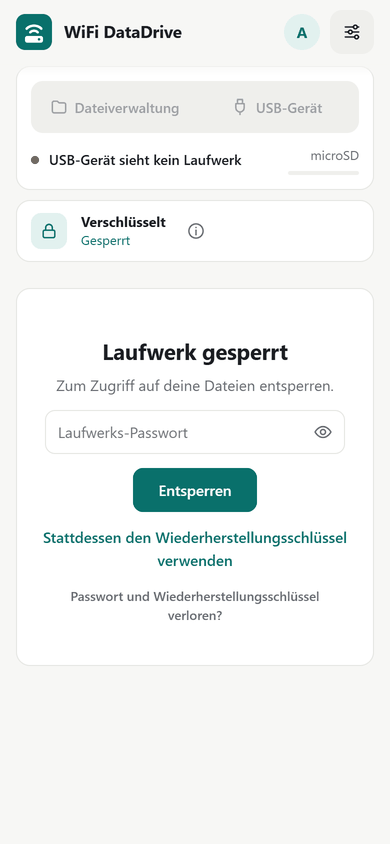
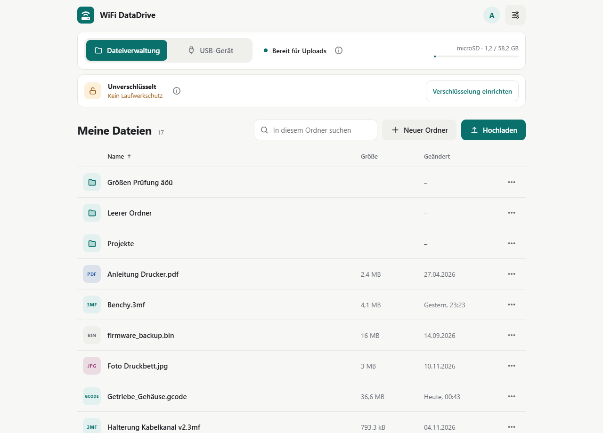
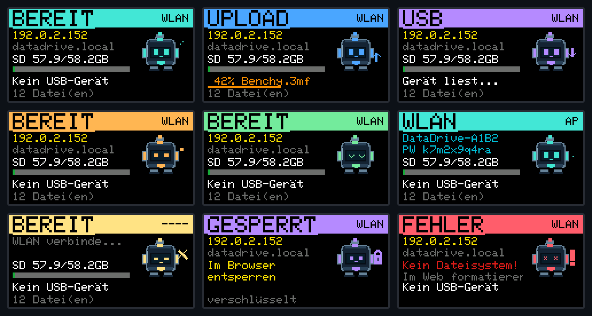
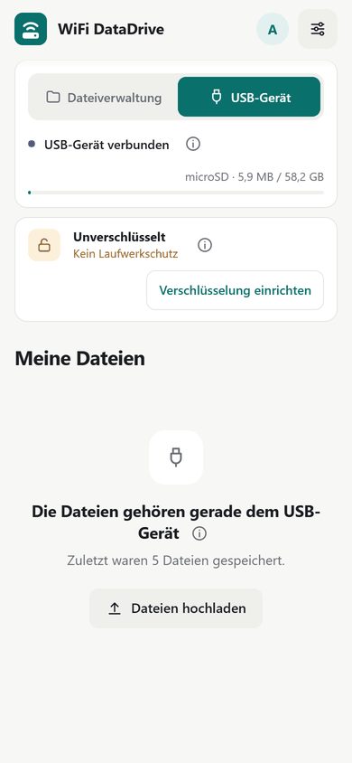
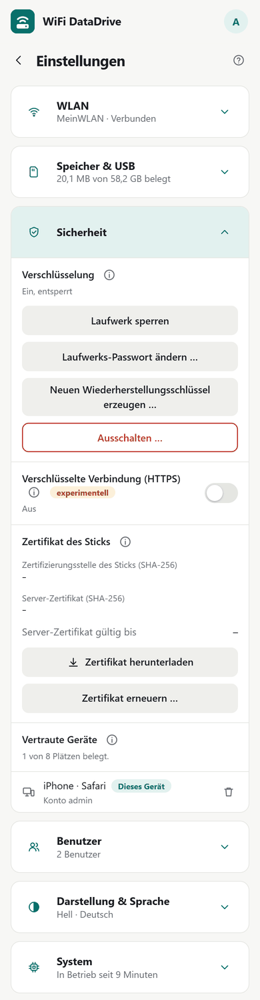

<p align="center">
  
</p>

<h1 align="center">WiFi DataDrive</h1>

<p align="center">
  <strong>WiFi DataDrive macht aus einem LILYGO T-Dongle-S3 einen USB-Stick mit WLAN.</strong><br>
  Das Gerät, in dem er steckt, sieht ein normales Laufwerk. Die Dateien darauf verwaltest du per Browser
  oder als Netzlaufwerk, ohne den Stick abzuziehen.
</p>

<p align="center">
  
  
  
  
  
  <a href="LICENSE"></a>
  
</p>

<p align="center">
  <a href="https://wliffers.github.io/wifi-datadrive/"></a>
  <a href="../../releases/latest"></a>
  <a href="https://www.linkedin.com/in/willi-liffers-71660b319/"></a>
</p>

<p align="center">
  <a href="https://buymeacoffee.com/wliffers"></a>
</p>

<p align="center">
  <a href="#funktionen">Funktionen</a> ·
  <a href="#anwendungsbeispiele">Anwendungsbeispiele</a> ·
  <a href="#installation">Installation</a> ·
  <a href="#erste-einrichtung">Einrichtung</a> ·
  <a href="#am-usb-gerät-benutzen">Am USB-Gerät</a> ·
  <a href="#verschlüsselung-einrichten-und-benutzen">Verschlüsselung</a> ·
  <a href="#netzlaufwerk-und-https">Netzlaufwerk &amp; HTTPS</a> ·
  <a href="#geprüft-und-nicht-geprüft">Prüfstand</a> ·
  <a href="#grenzen">Grenzen</a> ·
  <a href="#haftung-und-lizenz">Haftung &amp; Lizenz</a> ·
  <a href="README.en.md">English</a>
</p>

---

<p align="center">
  
</p>
<p align="center"><sub>Am Handy: entsperren, Dateien ansehen, hochladen, Einstellungen. Aufgenommen am Testserver mit Beispieldateien.</sub></p>

Der Dongle steckt in einem Gerät mit USB-Anschluss und erscheint dort als normales USB-Laufwerk. Über
WLAN öffnest du im Browser eine eingebaute Dateiverwaltung. Dort lädst du Dateien hoch und herunter,
benennst sie um, verschiebst und löschst sie, ohne den Stick abzuziehen. Dieselben Dateien erreichst du
auch als Netzlaufwerk, und auf Wunsch verschlüsselt der Stick die Speicherkarte.

Als USB-Gerät geprüft sind ein Windows-PC und ein 3D-Drucker: Der Bambu Lab X2D hat den Stick erkannt und
davon gedruckt, auch verschlüsselt. Für diesen Drucker ist das Projekt entstanden; heute ist er ein
Anwendungsbeispiel. Andere Geräte sind denkbar, aber nicht geprüft, siehe
[Anwendungsbeispiele](#anwendungsbeispiele).

Die Weboberfläche gibt es auf Deutsch und Englisch, am Handy wie am PC. Sie braucht kein Internet und
keine App.

> **Privates Projekt.** WiFi DataDrive ist ein Freizeitprojekt und steht in keiner Verbindung zu LILYGO,
> Espressif oder Bambu Lab. Die Software wird ohne Gewährleistung und ohne Haftung bereitgestellt.
> Einzelheiten stehen im [Haftungsausschluss](HAFTUNGSAUSSCHLUSS.md).

> **Stand 2026-11-14.** Der Quelltext trägt die Version 0.6.0, das erste Release. Sie läuft am Gerät: per
> Update über den Browser und über den Browser-Flasher installiert, mit dem API-Test geprüft (415/415) und
> mit signierten Updates. Am Gerät ausprobiert sind auch eine feste IP-Adresse mit eigenem Namen, das
> Sperren nach Ablauf der Zeit und das Drucken von einem verschlüsselten Stick. Was genau geprüft ist und
> was nicht, steht unter [Geprüft und nicht geprüft](#geprüft-und-nicht-geprüft).

## Funktionen

**Ein Stick, zwei Wege.**
Am USB-Gerät ist der Dongle ein gewöhnliches USB-Laufwerk. Über WLAN verwaltest du dieselben Dateien im
Browser.

**Immer nur einer greift zu.**
Das Laufwerk gehört zu jedem Zeitpunkt entweder dem USB-Gerät oder der Dateiverwaltung im Browser. Der
Stick schaltet kontrolliert um und fragt nach, wenn das USB-Gerät das Laufwerk noch benutzt.

**Dateien und Ordner.**
Hochladen per Knopf oder Drag & Drop, beliebige Dateitypen bis 4 GB pro Datei. Ordner anlegen,
umbenennen, verschieben, kopieren und löschen, auch mehrere Dateien auf einmal. Ordner lädst du als ZIP
herunter. Ein abgebrochener Upload geht an der Abbruchstelle weiter.

**Anmeldung mit Rollen.**
Bis zu 8 Benutzer mit den Rollen `admin` und `user`. Geräte, denen du vertraust, bleiben angemeldet.

**Verschlüsselung, wenn du willst.**
AES-256-XTS auf der Speicherkarte, in der Voreinstellung aus. Nach jedem Einstecken entsperrst du das
Laufwerk im Browser. Auf Wunsch sperrt es sich nach einer Zeit ohne Zugriff selbst, solange die
Dateiverwaltung das Laufwerk hat; ab 0.6.0 zeigt die Oberfläche die Restzeit an.

**Mehrere WLANs.**
Bis zu 5 Netze; der Stick verbindet sich mit dem stärksten. Beim Hinzufügen zeigt er die Netze in
Reichweite. Ab 0.6.0 gibt es eine feste IP-Adresse und einen eigenen Namen im Netzwerk (`name.local`).

**Netzlaufwerk und HTTPS.**
Der Stick ist zusätzlich als Netzlaufwerk (WebDAV) erreichbar. Eine verschlüsselte Verbindung (HTTPS)
lässt sich einschalten.

**Uhrzeit aus dem Netz.**
Dateien bekommen ein richtiges Datum. Die Zeitzone ist wählbar.

**Display und Taste.**
Das LCD zeigt Adresse, Zustand und Speicher, dazu das Maskottchen LIO. Ein Klick auf die Taste zeigt
die Adresse als QR-Code.

**Updates im Browser.**
Neue Firmware spielst du über die Weboberfläche ein. Startet sie nicht sauber, kehrt der Stick zur
bisherigen Version zurück. Ab 0.6.0 kann die Firmware so gebaut werden, dass sie nur signierte Updates
annimmt.

**Hilfe im Gerät.**
Die i-Symbole und die Seite „Hilfe & Anleitungen“ erklären jede Einstellung, auch ohne Internet.

<p align="center">
  
</p>

### Das Display

Das kleine Farbdisplay zeigt auf einen Blick, was der Stick gerade tut. Oben steht der Zustand in einer
farbigen Leiste, rechts oben das WLAN. Darunter folgen die Adresse für den Browser, der Speicher und was
das USB-Gerät gerade macht. Rechts zeigt das Maskottchen LIO den Zustand als kleine Animation. Die Farbe
der Leiste und die LED am Stick haben dieselbe Farbe wie LIO.

<p align="center">
  
</p>

| Leiste | LIO | Bedeutung |
|---|---|---|
| **BEREIT** türkis | ruhig | Die Dateiverwaltung hat das Laufwerk, du kannst im Browser hochladen. |
| **UPLOAD** blau | Pfeil nach oben | Ein Upload läuft; darunter Fortschritt und Dateiname. |
| **USB** lila | Pfeil nach unten | Das Laufwerk ist dem USB-Gerät bereitgestellt, und es liest oder schreibt gerade. Ruht das Gerät, zeigt LIO wieder „bereit“. |
| **BEREIT** orange | arbeitet | Kopieren, Formatieren oder ein Update läuft. |
| **BEREIT** grün | Haken | Das Laufwerk wurde gerade entsperrt (einmal, dann zurück zum normalen Zustand). |
| **WLAN** türkis, oben „AP“ | Funkwellen | Das Einrichtungs-WLAN des Sticks ist an. Name und Passwort stehen darunter; der QR-Code (Taste einmal drücken) verbindet das Handy direkt. |
| **BEREIT** gelb, oben „----“ | durchgestrichen | Kein WLAN; der Stick sucht seine gespeicherten Netze. |
| **GESPERRT** lila | Schloss | Das verschlüsselte Laufwerk ist gesperrt. Im Browser mit dem Laufwerks-Passwort entsperren; bis dahin sieht das USB-Gerät kein Laufwerk. |
| **FEHLER** rot | Warnzeichen | Zum Beispiel eine Karte ohne Dateisystem (im Browser formatieren) oder ein beschädigter Schlüsselbereich. |

Die unterste Zeile zeigt die Zahl der Dateien, im gesperrten Zustand „verschlüsselt“. Die Texte folgen der
Sprache der Weboberfläche (Deutsch oder Englisch). Das Bild oben ist aus den Daten der Firmware erzeugt
(Schrift, Farben, Animation; `tools/render_display.py`), kein Foto; die Adressen sind Beispielwerte.
LIO ist das Maskottchen des Autors und steht nicht unter der MIT-Lizenz, siehe
[LICENSE-LIO.md](LICENSE-LIO.md).

## Anwendungsbeispiele

Wo ein Gerät Dateien von einem USB-Stick liest, erspart WiFi DataDrive das Umstecken: Die Dateien kommen
per WLAN auf den Stick, und der Stick bleibt im Gerät.

**Geprüft: 3D-Drucker (Bambu Lab X2D).** Die geslicte Datei, zum Beispiel eine `.gcode.3mf`, kommt per
Browser vom PC oder Handy auf den Stick. Der Drucker zeigt sie an und druckt sie. Geprüft ohne
Verschlüsselung (Firmware 0.2.0 und 0.3.0) und mit verschlüsseltem, per Handy entsperrtem Stick (0.6.0).
Die Schritte stehen unter [Am USB-Gerät benutzen](#am-usb-gerät-benutzen).

**Geprüft: Windows-PC.** Unter Windows 11 ist der Stick ein normales Laufwerk: kopieren, auswerfen, neu
einstecken.

**Denkbar, aber nicht geprüft:** andere 3D-Drucker, Lasergravierer und CNC-Steuerungen, Papierdrucker mit
USB-Anschluss für Sticks, Fernseher und Mediaplayer, Autoradios, Stickmaschinen, Rechner mit macOS oder
Linux. Für keines dieser Geräte gibt es eine Aussage. Der Stick meldet sich als gewöhnlicher
USB-Massenspeicher mit Full Speed (12 Mbit/s), auf der microSD-Karte mit FAT32. Ob ein Gerät damit
zurechtkommt, zeigt nur ein Versuch. Bedenke auch: Solange du im Browser arbeitest, ist das Laufwerk für
das Gerät wie abgezogen. Wie ein Gerät darauf reagiert, ist ebenfalls nicht geprüft. Ergebnisse mit
anderen Geräten sind als [Rückmeldung](#rückmeldungen) willkommen.

## Was du brauchst

- **LILYGO T-Dongle-S3 mit LCD** (ESP32-S3, 16 MB Flash, microSD-Slot, eine Taste). Nur diese Variante
  ist gebaut und getestet. T-Dongle-S3 Plus und Dual sind nicht getestet.
- **microSD-Karte**, FAT32 empfohlen. Getestet ist eine 64-GB-Karte. Ohne Karte nutzt der Stick seinen
  internen Flash: etwa 11 MB, Schreiben etwa 46 KB/s.
- **Ein WLAN mit 2,4 GHz.** Der ESP32-S3 kann kein 5 GHz.
- **Ein Gerät, das USB-Sticks liest**, mit USB-A-Anschluss. Geprüft sind ein PC mit Windows 11 und der
  Bambu Lab X2D, siehe [Anwendungsbeispiele](#anwendungsbeispiele).
- **Chrome oder Edge** am PC oder Mac, wenn du im Browser flashen willst.

## Installation

**Voraussetzung:** Chrome oder Edge am PC oder Mac und ein USB-A-Anschluss für den Dongle.

1. Öffne den [Browser-Flasher](https://wliffers.github.io/wifi-datadrive/).
2. Halte die Taste am Dongle gedrückt, stecke ihn ein und lass die Taste nach etwa 2 Sekunden los. Der
   Dongle ist jetzt im Download-Modus.
3. Klicke auf **Installieren** und wähle den Anschluss des Dongles. Bei der ersten Installation
   beantwortest du die Frage „Erase device“ mit Ja.
4. Zieh den Dongle nach dem Flashen einmal ab und steck ihn wieder ein.

Das Gesamtabbild setzt Benutzer, gespeicherte WLANs und Einstellungen zurück. Die microSD-Karte wird
dabei nicht beschrieben. Die Flasher-Seite ist mit einem echten Dongle geprüft (0.6.0).

Ohne Browser geht es mit esptool:
`python -m esptool --chip esp32s3 write_flash 0x0 wifi-datadrive-vX.Y.Z-esp32s3-merged.bin`

<details>
<summary>Selbst bauen mit ESP-IDF</summary>

Du brauchst **ESP-IDF 5.5.6** (genau diese Version; die Komponenten sind in
`firmware/printdrive/dependencies.lock` festgelegt).

```sh
idf.py -C firmware/printdrive build
idf.py -C firmware/printdrive -p PORT flash
```

Unter Windows laden die Skripte in `tools/` die ESP-IDF-Umgebung selbst:

```powershell
.\tools\flash.ps1 -Project printdrive -Build -Monitor
```

`flash.ps1` findet den Anschluss und schickt einen laufenden Stick per Software in den Download-Modus.
Klappt das nicht, halte beim Einstecken die Taste und zieh den Dongle nach dem Flashen einmal ab. Lass
immer nur einen Build gleichzeitig laufen.

Eigene WLAN-Zugangsdaten kannst du fest einbauen: `firmware/pd_secrets.h.example` nach
`firmware/pd_secrets.h` kopieren (die Datei ist git-ignoriert). So gebaute Dateien gibst du nicht weiter.

Installation von ESP-IDF, Wiederherstellen der Werks-Firmware und alle Optionen:
[docs/04_build_und_flash.md](docs/04_build_und_flash.md).
</details>

## Erste Einrichtung

1. Ohne gespeichertes WLAN öffnet der Stick ein eigenes WLAN `DataDrive-XXXX`. Das Passwort steht auf
   dem Display. Verbinde dein Handy damit.
2. Die Einrichtungsseite soll sich von selbst öffnen (mit einem echten Handy **noch nicht geprüft**).
   Sonst gib im Browser `http://192.168.4.1` ein. Im Anmeldefenster des Handys klappt nur die
   WLAN-Einrichtung. Für Dateien schließt du es (iPhone: „Ohne Internet verwenden“) und nimmst den Browser.
3. Melde dich mit `admin` / `admin` an. Die Oberfläche verlangt sofort ein neues Passwort; vorher ist
   nichts anderes bedienbar.
4. Füge unter **Einstellungen › WLAN** dein WLAN hinzu. Danach erreichst du den Stick unter
   `http://datadrive.local` oder unter der Adresse auf dem Display.

**Adresse vergessen?** Ein Klick auf die Taste zeigt sie 20 Sekunden lang als QR-Code. Halte das Handy
davor und öffne den Link.

**Passwort vergessen?** Halte die Taste 10 Sekunden. Die Benutzer stehen dann wieder auf `admin` /
`admin`, ab 0.6.0 auch die Netzwerkeinstellungen. Deine Dateien bleiben erhalten, und ein verschlüsseltes
Laufwerk bleibt zu.

Die Bedienung an der Taste folgt dem Quelltext und ist am Gerät **noch nicht geprüft**. Alle
Tastenfunktionen stehen in [docs/09_api_v3.md](docs/09_api_v3.md) Abschnitt 9.

## Am USB-Gerät benutzen

Das Laufwerk hat immer genau einen Besitzer: das USB-Gerät, in dem der Stick steckt, oder die
Dateiverwaltung im Browser. Solange du im Browser arbeitest, sieht das USB-Gerät kein Laufwerk; gibst du
es zurück, sieht es die neuen Dateien.

1. Steck den Stick in den USB-Anschluss des Geräts. Oben in der Oberfläche ist **USB-Gerät** gewählt.
2. Lade im Browser deine Dateien hoch. Die Oberfläche holt sich das Laufwerk dafür, fragt nach, wenn das
   Gerät es noch benutzt, und gibt es nach dem Hochladen zurück.
3. Öffne die Datei am Gerät.

<p align="center">
  
</p>

**Nicht umschalten, während das Gerät liest.** „Dateiverwaltung“ nimmt dem USB-Gerät das Laufwerk weg.
Liest es gerade, bricht das ab. Sicherer ist es, das Laufwerk vorher am Gerät auszuwerfen.

Am PC funktioniert der Stick unter Windows 11 als normales Laufwerk.

### Beispiel: 3D-Drucker

1. Steck den Stick in den USB-Anschluss des Druckers.
2. Lade im Browser deine geslicte Datei hoch, zum Beispiel eine `.gcode.3mf`. Dateien mit der Endung
   `.3mf` prüft der Stick beim Hochladen auf Vollständigkeit.
3. Wähle die Datei am Drucker und starte den Druck.

**Nicht während eines Drucks umschalten.** Liest der Drucker gerade vom Stick, bricht der Druck ab. Ob der
X2D eine Datei beim Start ganz einliest oder währenddessen weiter vom Stick liest, ist nicht bekannt.
Sicherer ist es, das Laufwerk vorher am Drucker auszuwerfen.

Am Bambu Lab X2D hat der Autor geprüft: Laufwerk erkannt, per Browser hochgeladene `.gcode.3mf` angezeigt
und gedruckt (Firmware 0.2.0 und 0.3.0, microSD 64 GB FAT32, ohne Verschlüsselung), mit 0.6.0 auch von
einem verschlüsselten, per Handy entsperrten Stick. Gemessen wurde dabei nichts. Andere Drucker sind
nicht geprüft.

## Verschlüsselung einrichten und benutzen

Die Verschlüsselung ist optional und in der Voreinstellung aus. Sie schützt deine Dateien, wenn jemand die
Karte oder den Stick ohne das Laufwerks-Passwort in die Hand bekommt. Solange das Laufwerk entsperrt ist,
schützt sie nicht.

**Vorher:** Beim Einrichten werden alle Dateien gelöscht. Kopiere sie vorher auf den PC.

### Einrichten

1. Melde dich als `admin` an und wähle **Verschlüsselung einrichten** auf der Startseite oder unter
   **Einstellungen › Sicherheit**.
2. Wähle ein Laufwerks-Passwort mit mindestens 12 Zeichen. Es ist nicht dein Anmelde-Passwort. Am besten
   ist ein Satz aus mehreren Wörtern.
3. Tippe `LÖSCHEN` ein und bestätige. Auf einer 64-GB-Karte dauerte das 51 Sekunden. Zieh den Stick
   währenddessen nicht ab.
4. Schreib den **Wiederherstellungsschlüssel** auf und bewahre ihn getrennt vom Stick auf. Er wird nur
   einmal angezeigt.

### Verschlüsselt am USB-Gerät

1. Nach jedem Einstecken und nach jedem Stromausfall ist das Laufwerk gesperrt. Das USB-Gerät sieht dann
   kein Laufwerk.
2. Öffne die Oberfläche am Handy, gib das Laufwerks-Passwort ein und tippe auf **Entsperren**. Das
   USB-Gerät bekommt das Laufwerk danach.
3. Öffne die Datei am Gerät, am Drucker zum Beispiel zum Drucken.

Am 3D-Drucker: Der X2D druckt von einem verschlüsselten, per Handy entsperrten Stick (geprüft mit 0.6.0).

**Automatisch sperren** (Einstellungen › Speicher & USB, Voreinstellung aus): Das Laufwerk sperrt sich
nach der gewählten Zeit ohne Zugriff und, wenn du willst, sobald das USB-Gerät getrennt wird. Die Zeit
läuft ab 0.6.0 nur in der Dateiverwaltung: Ist das Laufwerk dem USB-Gerät bereitgestellt, sperrt es
nicht nach Zeit, damit das Gerät es nicht mitten in der Arbeit verliert (etwa während eines Drucks);
der Wechsel zurück in die Dateiverwaltung startet die Zeit neu. Während ein Upload läuft, wartet es. Die Startseite zeigt die Restzeit; „Zeit zurücksetzen“ startet
sie neu. Die Einstellungen und die Restzeit sind am Gerät geprüft (bei 15 Minuten nach wenigen Sekunden
895 s, nach dem Zurücksetzen 900 s), die Regel „nur in der Dateiverwaltung“ ebenfalls (5 Minuten: Countdown in der Dateiverwaltung, im
USB-Modus keiner, nach dem Zurückschalten volle Zeit). Das Sperren nach Ablauf der Zeit ist am Gerät
geprüft; das Sperren beim Trennen des USB-Geräts ist **noch nicht geprüft**.

**Passwort vergessen:** Entsperre mit dem Wiederherstellungsschlüssel und lege danach unter
**Einstellungen › Sicherheit › Verschlüsselung** ein neues Laufwerks-Passwort fest. Sind Passwort und
Schlüssel beide verloren, sind die Daten weg. Dann bleibt nur, das Laufwerk zu löschen und neu
einzurichten. Das Zurücksetzen per Taste hilft hier nicht.

**Ausschalten** löscht ebenfalls alle Dateien.

<p align="center">
  
</p>

Was die Verschlüsselung nicht leistet:

- **Die Stärke des Passworts ist der eigentliche Schutz.** Wer die Karte hat, kann Passwörter am PC
  durchprobieren. Ein kurzes Passwort schützt nicht.
- Die Wartezeit nach falschen Eingaben bremst nur das Raten über das Netzwerk.
- Gezielte Änderungen an den verschlüsselten Daten erkennt das Verfahren nicht.
- Ohne HTTPS geht das Laufwerks-Passwort beim Entsperren lesbar durchs WLAN.

Mehr dazu in [docs/12_api_v4.md](docs/12_api_v4.md) Abschnitt 2.5 und [docs/06_risiken.md](docs/06_risiken.md)
Abschnitt 8.

## Netzlaufwerk und HTTPS

### Als Netzlaufwerk verbinden

Unter `http://<Stick>/dav/` ist der Stick ein Netzlaufwerk (WebDAV). Du meldest dich mit demselben
Benutzer an wie im Browser.

- Das Netzlaufwerk geht nur, solange die Dateiverwaltung aktiv ist. Dem USB-Gerät nimmt es das Laufwerk
  nie weg.
- Ein verschlüsseltes Laufwerk muss entsperrt sein.
- Abschalten kannst du es unter Einstellungen › WLAN.

Am Gerät ist das Netzlaufwerk nur per API-Test geprüft. Mit echten Programmen ist es **noch nicht
geprüft**. Die Bedingungen in der Tabelle stammen aus Recherche, nicht aus eigenen Tests:

| Programm | Bedingung |
|---|---|
| Windows-Explorer | Verbindet sich über `http` erst nach einer einmaligen Einstellung in der Registry, die für alle WebDAV-Server gilt. Das Skript `tools\webdav\Connect-DataDrive.ps1` fragt vorher und setzt sie. |
| iPhone und iPad | Die App „Dateien“ kann kein WebDAV. Du brauchst eine zusätzliche App. |
| macOS-Finder | Anzeigen und Herunterladen gehen, Hineinkopieren nicht. |

Schritte und Fehlermeldungen: [tools/webdav/README.md](tools/webdav/README.md).

### HTTPS einschalten

Ohne HTTPS gehen Passwörter und Dateien lesbar durchs WLAN. HTTPS ist eingebaut, der Schalter steht aber
auf aus.

1. Melde dich als `admin` an und schalte unter **Einstellungen › Sicherheit** die „Verschlüsselte
   Verbindung (HTTPS)“ ein.
2. Bestätige den Neustart. Ein angeschlossenes USB-Gerät verliert das Laufwerk dabei kurz.
3. Danach erreichst du den Stick unter `https://<Stick>/`. Aufrufe mit `http://` werden umgeleitet.
4. Jeder Browser warnt, bis das Zertifikat des Sticks installiert ist. Lade es unter
   **Einstellungen › Sicherheit › Zertifikat herunterladen** und installiere es einmal auf jedem Gerät:
   - **Windows:** Datei öffnen › Zertifikat installieren › Lokaler Computer › Speicher
     „Vertrauenswürdige Stammzertifizierungsstellen“.
   - **iPhone:** in Safari herunterladen, Einstellungen › Profil geladen › Installieren, dann
     Allgemein › Info › Zertifikatsvertrauenseinstellungen: Vertrauen einschalten.

Danach müssen Skripte („Senden an“, Kurzbefehl, eigene Skripte) `https://` benutzen, und ein Symbol auf
dem Home-Bildschirm legst du neu an. Der Stick bedient immer nur eine HTTPS-Verbindung gleichzeitig; die
Oberfläche schickt deshalb ab 0.6.0 eine Anfrage nach der anderen. Ab 0.6.0 gilt außerdem: Ein neuer Name
im Netzwerk erzeugt ein neues Zertifikat des Sticks, das du auf jedem Gerät neu installierst. Eine neue
Adresse erneuert nur das Serverzertifikat; neu installieren musst du dann nichts.

Am Gerät gemessen (0.5.0, Laufwerk verschlüsselt und entsperrt): Upload von 30 MB mit 864 kB/s, die Datei
war danach bitgleich; Download 389 kB/s. Mit 0.6.0 (HTTPS an, Laufwerk entsperrt): 67 KiB freier Speicher
im Leerlauf. **Noch nicht geprüft:** die Installation des Zertifikats auf iPhone und Windows, Netzlaufwerk
und Skripte über `https`, Betrieb über viele Stunden. Bekannte Lücke: Downloads und ZIP-Downloads öffnen
eine eigene Verbindung im Browser. Mit HTTPS kann eine Statusabfrage während eines langen Downloads diese
Verbindung noch schließen.

## Updates

**Über den Browser:** Einstellungen › System › „Datei auswählen …“, dann die Datei `…-app.bin` aus dem
Release wählen. Die neue Version läuft zuerst zur Probe; startet sie nicht stabil, kehrt der Stick zur
bisherigen zurück. Dateien und Einstellungen bleiben. Am Gerät geprüft ist ein Update von 0.5.0 auf 0.6.0:
angenommen nach 13 Sekunden, Neustart in den zweiten Firmware-Bereich, nach 15 Sekunden als gut bestätigt.
Die Rückkehr zur alten Version nach einem Fehlstart ist am Gerät **noch nicht geprüft**.

**Signierte Updates (ab 0.6.0):** Eine mit der Option `CONFIG_PD_OTA_SIGNED` gebaute Firmware installiert
über den Browser nur noch Dateien, die mit dem Schlüssel des Autors signiert sind (RSA-3072). Auch ein
Administrator mit richtigem Passwort kann dann keine veränderte Firmware übers Netz einspielen. Signiert
wird nur auf dem Rechner des Autors; der private Schlüssel liegt außerhalb des Repositorys und kommt nie zu
GitHub. Die Bestätigung vor dem Update zeigt „Nur signierte Updates“ und die Schlüssel-ID. Am Gerät
geprüft: Eine unsignierte Datei wird mit `UNSIGNED` abgewiesen, eine mit einem anderen Schlüssel signierte
mit `BAD_SIGNATURE`; der Stick läuft danach ohne Neustart weiter.

**Forks und eigene Builds:** In der Voreinstellung baut das Repository ohne Signatur. So eine Firmware
nimmt jedes gültige Update an, wie 0.5.0. Auf einen Stick mit signierter Firmware kommt dein eigener Build
nur per USB. Eigene signierte Builds mit eigenem Schlüssel und was die Signatur nicht schützt (USB-Zugriff,
kein Secure Boot): [docs/17_signierte_updates.md](docs/17_signierte_updates.md).

## Geprüft und nicht geprüft

**Geprüft** heißt hier: am echten Gerät ausprobiert, mit Ergebnis in
[docs/05_testprotokoll.md](docs/05_testprotokoll.md). Alles andere steht als nicht geprüft da, auch wenn es
gebaut ist oder am Testserver läuft.

| Bereich | Stand |
|---|---|
| USB-Laufwerk unter Windows 11: kopieren, auswerfen, neu einstecken | geprüft |
| microSD 64 GB FAT32 | geprüft (eine Karte) |
| Bambu Lab X2D ohne Verschlüsselung: Laufwerk erkannt, Datei angezeigt, gedruckt | Rückmeldung des Autors (0.2.0 und 0.3.0), keine Messung |
| Drucken am X2D von einem verschlüsselten, entsperrten Stick (0.6.0) | Rückmeldung des Autors (2026-11-14), keine Messung |
| Lange Drucke, Umschalten während eines Drucks, Nur-Lese-Modus | nicht geprüft |
| Andere USB-Geräte: andere Drucker, Lasergravierer, CNC-Steuerungen, Fernseher, Mediaplayer, Autoradios, Rechner mit macOS oder Linux | nicht geprüft |
| Anmeldung, Benutzer, Ordner, mehrere WLANs (0.3.0) | geprüft per API-Test am Gerät (182/182) |
| Verschlüsselung: einrichten, sperren, entsperren, Wiederherstellung, ausschalten (0.4.0) | geprüft per API-Test am Gerät (334/334) |
| Verschlüsselung auf dem internen Flash, Stromausfall beim Einrichten | nicht geprüft |
| Netzlaufwerk-Grundfunktionen, Uhrzeit, Upload fortsetzen, ZIP, Einstellungen zum Sperren (0.5.0) | geprüft per API-Test am Gerät (354/354) |
| API-Test 0.6.0: Umfang von 0.3.0 bis 0.5.0, dazu Restzeit, Netzwerkeinstellungen und Felder für signierte Updates | geprüft per API-Test am Gerät (415/415, 7 übersprungen, Liste im Testprotokoll Phase 10) |
| HTTPS (0.5.0) | Grundfunktion am Gerät gemessen; mit 0.6.0 67 KiB freier Speicher im Leerlauf; iPhone mit Zertifikat, WebDAV über `https`, Dauerbetrieb nicht geprüft |
| Netzlaufwerk mit Explorer, Finder oder Handy-Apps | nicht geprüft |
| Restzeit bis zum Sperren und „Zeit zurücksetzen“ (0.6.0) | geprüft per API am Gerät (15 Minuten: 895 s, nach dem Zurücksetzen 900 s) |
| Automatisches Sperren nach Ablauf der Zeit (0.6.0) | geprüft am Gerät (Rückmeldung des Autors, 2026-11-14); Sperren beim Trennen des USB-Geräts nicht geprüft |
| Sperren nach Zeit nur in der Dateiverwaltung, im USB-Modus kein Countdown (0.6.0) | geprüft per API am Gerät (Dateiverwaltung 294 s, USB-Modus -1, zurück 293 s), dazu API- und Browser-Test gegen den Testserver |
| Netzwerkeinstellungen lesen (0.6.0): DHCP, Adresse, Maske, Gateway, DNS, Name | geprüft am Gerät |
| Feste IP-Adresse und neuen Namen im Netzwerk einstellen (0.6.0) | geprüft am Gerät (Rückmeldung des Autors, 2026-11-14); Zurücksetzen per Taste nicht geprüft |
| Einrichtungsseite öffnet sich von selbst, WLAN-Suche im Einrichtungs-WLAN | nicht geprüft |
| Taste (QR-Code, Umschalten, Zurücksetzen von Benutzern und Netzwerk), App-Symbol am Handy, „Senden an“, iPhone-Kurzbefehl | nicht geprüft |
| Firmware-Update über den Browser (0.5.0 auf 0.6.0) | geprüft (einmal; Rückkehr nach einem Fehlstart nicht geprüft) |
| Signierte Updates (0.6.0): unsignierte und fremd signierte Datei abgewiesen | geprüft am Gerät (`UNSIGNED`, `BAD_SIGNATURE`, kein Neustart) |
| Browser-Flasher (0.6.0) | geprüft mit einem echten Dongle (Rückmeldung des Autors, 2026-11-14) |
| Weboberfläche (0.6.0) | Browser-Test gegen den Testserver bestanden (Chromium, PC 878/878, Handy-Profil 895/895); an einem echten Handy nicht systematisch geprüft |
| Fehler „Stick nicht erreichbar“ nach Ändern der Sperrzeit (HTTPS) | behoben mit einer Warteschlange für Anfragen, nachgestellt mit einem Modell, das nur eine Verbindung annimmt; am iPhone noch nicht nachgeprüft |

Gemessen mit microSD 64 GB: USB schreiben 832 KB/s, Upload im Browser 1,3 bis 1,6 MB/s. Verschlüsselt:
USB schreiben 820 KB/s, lesen 659 KB/s, Upload 1,0 MB/s. Offene Risiken und Annahmen stehen in
[docs/06_risiken.md](docs/06_risiken.md).

## Gespeicherte und gelesene Daten

- **Auf der Speicherkarte** (ohne Karte im internen Flash): deine Dateien. Mit Verschlüsselung zusätzlich
  ein Kopfbereich mit dem verschlüsselten Laufwerksschlüssel. Das Laufwerks-Passwort selbst wird nirgends
  gespeichert.
- **Im Einstellungsspeicher des Sticks:** die Benutzer mit Rolle und gesalzenem Passwort-Hash, nie das
  Passwort im Klartext; vertraute Geräte als Hash; die gespeicherten WLANs mit Passwort,
  **unverschlüsselt**; Netzwerk- und Geräteeinstellungen; bei HTTPS das Zertifikat und der Schlüssel des
  Sticks. Wer den Stick in der Hand hat, kann diesen Speicher per USB auslesen.
- **Im Browser:** Darstellung, die Einstellung „Nach dem Hochladen wieder bereitstellen“ und das
  Sitzungs-Cookie.
- **Protokoll:** die letzten 8 KB Meldungen für die Fehlersuche, lesbar unter Einstellungen › System.
- **Internet:** keine Cloud, kein Konto, keine Telemetrie. Die einzige Verbindung nach außen ist die
  Uhrzeit per NTP (`pool.ntp.org` oder der Zeitserver, den dein Router nennt). Die Weboberfläche lädt
  nichts von fremden Servern. Im WLAN meldet sich der Stick per mDNS als `datadrive.local`.
- **Browser-Flasher:** Die Flasher-Seite lädt ESP Web Tools von unpkg.com und das Firmware-Abbild aus dem
  Release auf GitHub.

## Grenzen

- Gebaut und getestet nur für den LILYGO T-Dongle-S3 mit LCD.
- Als USB-Gerät geprüft sind nur ein PC mit Windows 11 und der Bambu Lab X2D.
- Gedacht für vertrauenswürdige Netze. In der Voreinstellung spricht der Stick nur HTTP; Passwörter gehen
  dann lesbar durchs WLAN.
- Der Stick bearbeitet eine Anfrage nach der anderen. Während eines Uploads warten andere Geräte. Mit
  HTTPS kann ein langer Download abbrechen, wenn die Oberfläche währenddessen den Status abfragt.
- Kein exFAT. Viele Karten über 32 GB kommen mit exFAT und müssen im Browser auf FAT32 formatiert werden;
  dabei gehen ihre Daten verloren. Höchstens 4 GB pro Datei.
- Die Karte wechselst du nur bei ausgestecktem Stick.
- USB läuft mit Full Speed (12 Mbit/s). Am PC gemessen: Schreiben etwa 0,8 MB/s, Lesen etwa 0,75 MB/s.
  Ohne Karte ist der interne Flash klein und langsam.
- Der Stick nimmt jeden Dateityp an. Nur Dateien mit der Endung `.3mf` prüft er beim Hochladen auf
  Vollständigkeit; andere Inhalte prüft er nicht.
- Wer die Taste 10 Sekunden hält, setzt die Anmeldung auf `admin` / `admin` zurück. Ein verschlüsseltes
  Laufwerk öffnet das nicht.
- Ohne Internet stellt der Browser die Uhr. Nach einem Stromausfall ist sie unbekannt, bis Netz oder
  Browser sie wieder stellen.

## Rückmeldungen

Fehlerberichte, Testergebnisse von echter Hardware und Vorschläge sind als Issue willkommen, besonders
Ergebnisse mit USB-Geräten, die noch nicht geprüft sind. Hilfreich sind Firmware-Version, Board, Speicher
(microSD oder interner Flash, verschlüsselt ja/nein), das USB-Gerät (zum Beispiel Druckermodell, PC mit
Betriebssystem, Fernseher) und die letzten Zeilen aus dem Protokoll, ohne Passwörter und WLAN-Namen.
Sicherheitslücken meldest du bitte vertraulich, siehe [.github/SECURITY.md](.github/SECURITY.md).

WiFi DataDrive wird in der Freizeit gepflegt. Ich antworte, sobald ich kann, kann aber keine
Antwortzeiten oder Korrekturen zusagen. Mehr dazu in [CONTRIBUTING.md](CONTRIBUTING.md).

## Für Entwickler

```
firmware/printdrive/       Hauptfirmware: Laufwerk, USB, Anmeldung, Web-API, WebDAV, ZIP, Update, HTTPS, Display
  main/web/index.html      Weboberfläche; wird beim Bauen gzip-komprimiert eingebettet
firmware/components/       board, st7735, display, pd_wifi, pd_crypt, pd_time, applog
firmware/smoke_test/       Hardwaretest: LCD, LED, Taste, Flash, WLAN
tools/flash.ps1, idf.ps1   Bauen und Flashen unter Windows; findet Anschluss und Download-Modus selbst
tools/mock_server.py       Testserver: bildet die Geräte-API ohne Hardware nach
tools/api_test.py          API-Test gegen den Testserver oder das echte Gerät
tools/ui_test.py           Browser-Test der Weboberfläche (Playwright mit Edge oder Chrome)
tools/signing/             Schlüssel erzeugen, signiert bauen, Signatur prüfen
tools/sendto/, webdav/     „Senden an“ und Netzlaufwerk unter Windows
web-flasher/               Browser-Flasher für GitHub Pages
docs/                      Projektdokumentation (deutsch)
```

```bash
python -m pip install -r requirements-dev.txt               # Python 3.10 oder neuer
idf.py -C firmware/printdrive build                         # ESP-IDF 5.5.6
python tools/mock_server.py --port 8090                     # dann http://127.0.0.1:8090/ (admin / admin123)
python tools/api_test.py 127.0.0.1:8090 --user admin --password admin123
python tools/ui_test.py --base http://localhost:8090        # bei Änderungen an der Weboberfläche
```

Der Projektordner `firmware/printdrive`, der Header `X-PrintDrive` und die Präfixe `pd_` und `PD_` stammen
aus der Zeit, als das Projekt „WiFi PrintDrive“ hieß und nur für den 3D-Drucker gedacht war; sie bleiben,
damit Builds, Skripte und Einstellungen weiter funktionieren.

Der Kern des Projekts ist die Ein-Besitzer-Regel des Laufwerks; sie steht in Kurzform in
[docs/00_kern_usb_gadget.md](docs/00_kern_usb_gadget.md) und ausführlich in
[docs/02_architektur.md](docs/02_architektur.md). Änderungen an der API kommen zuerst in den API-Vertrag
(zuletzt [docs/16_api_v6.md](docs/16_api_v6.md)), dann in Firmware, Testserver und API-Test. GitHub
Actions baut jeden Push mit ESP-IDF 5.5.6 und testet gegen den Testserver; die Workflows sind geschrieben,
aber noch nicht auf GitHub gelaufen. Der Ablauf eines Releases steht in [docs/RELEASING.md](docs/RELEASING.md),
die Änderungen je Version in [CHANGELOG.md](CHANGELOG.md).

<details>
<summary>Alle Dokumente in docs/</summary>

| Datei | Inhalt |
|---|---|
| [00_kern_usb_gadget.md](docs/00_kern_usb_gadget.md) | der Kern in Kurzform: Besitzer-Prinzip, Sicherungen, Eckdaten |
| [01_bestandsaufnahme.md](docs/01_bestandsaufnahme.md) | Hardware, verifizierte Daten, Technologieentscheidung |
| [02_architektur.md](docs/02_architektur.md) | Module, Besitzer-Zustandsautomat, Upload, Weboberfläche, Anmeldung, Verschlüsselung |
| [03_umsetzungsplan.md](docs/03_umsetzungsplan.md) | Phasen 0 bis 8, Abnahmekriterien |
| [04_build_und_flash.md](docs/04_build_und_flash.md) | ESP-IDF, Bauen, Flashen, Wiederherstellen, Konfiguration, Tests, Testserver |
| [05_testprotokoll.md](docs/05_testprotokoll.md) | Testprozeduren und Ergebnisse je Version |
| [06_risiken.md](docs/06_risiken.md) | offene Risiken, ungeprüfte Punkte, Annahmen |
| [07_api.md](docs/07_api.md) | HTTP-API Version 2 (historisch) |
| [08_plan_v03.md](docs/08_plan_v03.md) | Plan Version 0.3.0 |
| [09_api_v3.md](docs/09_api_v3.md) | HTTP-API Version 3: Anmeldung, Rollen, Dateien, Ordner, WLAN, Taste |
| [10_senden.md](docs/10_senden.md) | Senden vom iPhone (Kurzbefehl), App-Symbol am Handy |
| [11_plan_v04.md](docs/11_plan_v04.md) | Plan Version 0.4.0 |
| [12_api_v4.md](docs/12_api_v4.md) | HTTP-API Version 4: WLAN-Suche, Verschlüsselung, HTTPS; Schutzwirkung in Abschnitt 2.5 |
| [13_display_animation_briefing.md](docs/13_display_animation_briefing.md) | Vorgaben für die Anzeige „LIO“ |
| [14_vormerkliste.md](docs/14_vormerkliste.md) | Vormerkliste: umgesetzt, offen, nicht entschieden |
| [15_api_v5.md](docs/15_api_v5.md) | HTTP-API Version 5: Uhrzeit, automatisches Sperren, Upload fortsetzen, ZIP, WebDAV |
| [16_api_v6.md](docs/16_api_v6.md) | HTTP-API Version 6: Restzeit bis zum Sperren, Netzwerkeinstellungen, signierte Updates |
| [17_signierte_updates.md](docs/17_signierte_updates.md) | Signierte Updates: Schutz, Einrichtung, Schlüsselverlust, Testschritte |
| [18_veroeffentlichung.md](docs/18_veroeffentlichung.md) | einmalige Checkliste für die Veröffentlichung auf GitHub |
| [RELEASING.md](docs/RELEASING.md) | Ablauf eines Releases |
| [tools/webdav/README.md](tools/webdav/README.md) | Netzlaufwerk verbinden: Windows, iPhone, Android, macOS, Linux |
| [tools/sendto/README.md](tools/sendto/README.md) | „Senden an“ für Windows |
| [tools/signing/README.md](tools/signing/README.md) | Werkzeuge für signierte Updates |
</details>

## Haftung und Lizenz

- **Lizenz:** [MIT](LICENSE) – frei nutzbar, auch im Betrieb, ohne Gewährleistung.
- **Maskottchen LIO:** Name, Figur und Grafiken stehen nicht unter der MIT-Lizenz; die Rechte liegen beim
  Autor. Wer eine eigene Fassung der Firmware veröffentlicht, ersetzt die Grafiken.
  [LICENSE-LIO.md](LICENSE-LIO.md)
- **Haftungsausschluss:** Benutzung auf eigene Gefahr. Sichere deine Dateien, bewahre Passwort und
  Wiederherstellungsschlüssel getrennt auf und prüfe, was das angeschlossene Gerät mit den Dateien macht,
  am Drucker zum Beispiel den Druck. [HAFTUNGSAUSSCHLUSS.md](HAFTUNGSAUSSCHLUSS.md)
- **Fremdanteile:** ST7735-Treiber von LILYGO (MIT), 5×7-Schrift aus Adafruit GFX (BSD), dazu ESP-IDF,
  TinyUSB und weitere Komponenten mit ihren eigenen Lizenzen. Alles Weitere, auch die Pflichten bei der
  Weitergabe von Firmware-Dateien, in [THIRD_PARTY_NOTICES.md](THIRD_PARTY_NOTICES.md).
- **Marken:** LILYGO ist eine Marke ihres Inhabers. Espressif und ESP32 sind Marken von Espressif Systems.
  Bambu Lab ist eine Marke von Bambu Lab. WiFi DataDrive ist ein unabhängiges Projekt und mit keinem der
  Genannten verbunden.

---

<p align="center">Version 0.6.0 · Stand 2026-11-13</p>
