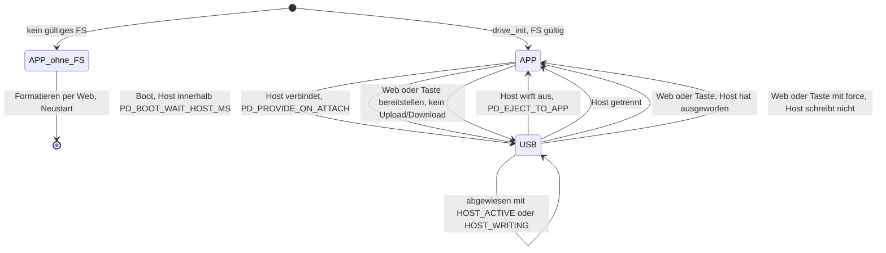

# 02 – Architektur

Beschreibt den Stand des Quellcodes in `firmware/`. Verhalten auf echter Hardware ist
noch nicht verifiziert (siehe [03_umsetzungsplan.md](03_umsetzungsplan.md)).

## 1. Module

| Modul | Ort | Aufgabe |
|---|---|---|
| `board` | `components/board` | Pins (`board.h`), APA102-LED (Bit-Banging), BOOT-Taste, Flash-Größe, Neustart in den ROM-Download-Modus (`RTC_CNTL_FORCE_DOWNLOAD_BOOT`) |
| `st7735` | `components/st7735` | `esp_lcd`-Paneltreiber (LILYGO, MIT) |
| `display` | `components/display` | RAM-Framebuffer 160×80 RGB565, 5×7-Font (ASCII + Umlaute), `display_flush()` per DMA |
| `pd_wifi` | `components/pd_wifi` | STA, Setup-AP, Reconnect mit Backoff (2–30 s), mDNS |
| `applog` | `components/applog` | hängt sich in `esp_log`, 8-KB-Ringpuffer für `/api/log`, optionaler Sink (CDC) |
| `drive` | `printdrive/main/drive.c` | **Besitzer-Verwaltung** des Dateisystems, Formatieren, Dateioperationen, Upload-Pipeline |
| `usb_dev` | `printdrive/main/usb_dev.c` | TinyUSB-Installation, Konfigurationsdeskriptor, CDC-Log-Port, 1200-Baud-Touch, Soft-Re-Plug, Barrier |
| `web_server` | `printdrive/main/web_server.c` | HTTP-API und eingebettete Weboberfläche (`web/index.html`) |
| `ui` | `printdrive/main/ui.c` | LCD-Statusbild, LED-Farbe, BOOT-Taste |

Startreihenfolge (`app_main.c`): `applog_init` → NVS (bei veraltetem Format nur NVS
löschen) → `board_init` → `ui_init` (BOOT-Bild) → `drive_init` (Speicher + USB; bei
Fehler: LCD `FEHLER` „Speicher/USB Init“, Abbruch ohne WLAN/Web) → `pd_wifi_start` →
`web_server_start` → `ui_start`.

## 2. Speicher und Flash-Layout

`firmware/partitions.csv` (gemeinsam für Smoke-Test und Hauptfirmware):

| Name | Typ | Offset | Größe | Zweck |
|---|---|---|---|---|
| nvs | data/nvs | 0x9000 | 0x5000 (20 KB) | WLAN-Daten, Flags |
| otadata | data/ota | 0xE000 | 0x2000 | OTA-Auswahl |
| ota_0 | app | 0x10000 | 0x280000 (2,5 MB) | Firmware |
| ota_1 | app | 0x290000 | 0x280000 (2,5 MB) | Reserve für spätere OTA |
| storage | data/fat | 0x510000 | 0xAF0000 (10,94 MiB) | Dateispeicher, endet genau bei 16 MiB |

Das Layout ist von Anfang an OTA-fähig, damit ein späteres OTA keine
Neupartitionierung (= Verlust der Dateien) erfordert.

Dateisystem-Stapel: Partition → **Wear Levelling** (512-B-Sektoren, SAFE-Modus,
`sdkconfig.defaults`) → FAT. Die Firmware formatiert selbst mit **MBR + FAT16**,
Clustergröße 2048 B, Label `PRINTDRIVE` (esp_tinyusbs eigener Formatierer würde hier
FAT12 erzeugen). Der USB-Host sieht dieselben 512-B-Sektoren.

Formatieren (`probe_and_format()` in `drive_init`, immer **vor** dem Start von USB):

- automatisch nur beim **ersten Start**: kein gültiges FAT und NVS-Flag `fmt_done` fehlt;
- sonst nur auf Anforderung über die Weboberfläche: NVS-Flag `fmt_req` setzen → Neustart → Formatieren;
- ein vorhandenes, aber defektes Dateisystem wird **nie still neu formatiert**: LCD zeigt
  „Kein Dateisystem! / Im Web formatieren“, das Laufwerk wird auch dem Host nicht angeboten.

## 3. Besitzer-Zustandsautomat (Kern)

Das FAT hat immer genau einen Besitzer (`drive_owner_t`):

| Besitzer | Lokal (`/data`) | USB-Host |
|---|---|---|
| `APP` („Upload-Modus“) | gemountet; Web darf listen, hochladen, löschen | sieht „kein Medium“ (wie leerer Kartenleser), jedes READ/WRITE wird abgewiesen |
| `USB` („bereitgestellt“) | nicht gemountet, alle Dateioperationen → `WRONG_OWNER` | exklusiver Sektorzugriff |

### Mechanismen

1. **`auto_mount_off`**: esp_tinyusb schaltet nie selbst um. Der Automatik-Modus würde das
   FAT beim Anstecken eines Hosts unter einer offenen Upload-Datei aushängen.
2. **Host-I/O-Sperre** per Linker-`--wrap` (siehe `printdrive/main/CMakeLists.txt`) um
   `tud_msc_read10_cb`, `tud_msc_write10_cb`, `tud_msc_test_unit_ready_cb`:
   - solange APP besitzt: Sense `NOT READY / 0x3A` (MEDIUM NOT PRESENT) – auch für Hosts,
     die TEST UNIT READY ignorieren;
   - Host nur lesend: WRITE → Sense `DATA PROTECT / 0x27` (write protected);
     zusätzlich meldet `tud_msc_is_writable_cb` den Schreibschutz.
   Wrappen geht nur bei Callbacks ohne schwache Default-Implementierung in TinyUSB.
3. **Barrier**: Vor dem Mounten durch die App wird neue Host-I/O gesperrt und dann über
   `usbd_defer_func` eine Marke in die TinyUSB-Task gestellt (`usb_dev_barrier`, Timeout
   2 s). Erst wenn sie ankommt, sind alle bereits angenommenen, verzögert ausgeführten
   Host-Schreibzugriffe erledigt – esp_tinyusb 2.4.0 wartet darauf selbst nicht.
   Timeout → Log `USB barrier timeout - host writes may still be pending`, Umschaltung
   wird abgebrochen (`IO`).
4. **Medienwechsel**: Nach dem Bereitstellen meldet das erste TEST UNIT READY
   `UNIT ATTENTION / 0x28` („medium may have changed“), damit der Host seinen FAT-Cache
   verwirft.
5. **Soft-Re-Plug**: Beim Bereitstellen über Web/Taste wird zusätzlich `tud_disconnect()`
   → 600 ms → `tud_connect()` ausgeführt, wenn `CONFIG_PD_REPLUG_ON_PROVIDE` gesetzt ist
   (Default) oder der Host vorher ausgeworfen hatte (sonst schaut er nie wieder hin).
   Das dadurch ausgelöste DETACHED-Ereignis wird 4 s lang ignoriert. Beim Boot und beim
   Anstecken wird nicht re-plugged.
6. **Auswurf-Erkennung**: `tud_msc_scsi_complete_cb` wertet START STOP UNIT (0x1B) aus;
   `LOEJ && !START` = Auswerfen → Ereignis `EV_HOST_EJECT`.

### Umschaltregeln (`drive_set_owner`)

| Ziel | Bedingung | Ergebnis |
|---|---|---|
| beliebig | Upload aktiv oder Download offen | `BUSY` |
| USB | kein gültiges FS | `NO_FS` |
| USB | sonst | OK (+ Re-Plug wie oben) |
| APP | Host nicht verbunden oder hat ausgeworfen | OK |
| APP | Host hält das Laufwerk, darf schreiben und schrieb vor < `CONFIG_PD_HOST_WRITE_GUARD_MS` | `HOST_WRITING` – auch mit `force` |
| APP | Host hält das Laufwerk, ohne `force` | `HOST_ACTIVE` |
| APP | Host hält das Laufwerk, mit `force` | OK, Log `taking the drive from the host (confirmed by user)` |

Automatische Wechsel (Task `drive`): Boot-Politik – bis `CONFIG_PD_BOOT_WAIT_HOST_MS`
auf einen Host warten, dann bereitstellen (`host present at boot -> providing drive`),
sonst Upload-Modus (`no USB host at boot -> staying in upload mode`). Host-Anstecken →
bereitstellen (wenn nicht beschäftigt). Host getrennt oder Auswurf → APP.

Die Einstellung „Host darf schreiben“ (NVS `pd_drive/host_wr`, Default aus
`CONFIG_PD_HOST_WRITABLE_DEFAULT`) wirkt erst beim nächsten Bereitstellen.

## 4. Upload-Pipeline

1. Browser fragt `POST /api/upload/check` (Name, Größe, overwrite) – führt dieselben
   Prüfungen wie der echte Upload aus (begin + abort).
2. `POST /api/upload`: Rohdaten im Body (`application/octet-stream`), Länge = `Content-Length`.
3. Prüfungen in `drive_upload_begin`: Name (≤ 120 Byte UTF-8, keine Steuerzeichen,
   kein `/\:*?"<>|`, nicht mit Punkt/Leerzeichen beginnend oder endend), Endung `.3mf`
   (optional `.gcode`), Größe > 0, Zielname existiert nicht (oder overwrite), freier
   Platz ≥ Größe + 64 KB Reserve (die alte Datei wird erst nach Erfolg gelöscht).
4. Daten → Temp-Datei `/data/.pd_upload.tmp` (16-KB-Blöcke). Mehr Daten als angekündigt → `INVALID_FILE`.
5. Abschluss: Größe exakt, `fsync`; bei `.3mf` ZIP-Kopf `PK\3\4` und ZIP-End-of-Central-
   Directory `PK\5\6` in den letzten 1024 Byte; erst dann ggf. alte Datei löschen und
   **umbenennen**. Log `upload ok '<name>'` bzw. `upload failed '<name>': <Text>`.
6. Abbruch (Verbindung weg, 3 Timeouts à 10 s) → Temp-Datei gelöscht
   (`upload aborted '<name>' after <n> bytes`).
7. Liegengebliebene Temp-Dateien (Stromausfall) werden bei jedem Mounten durch die App
   gelöscht (`removing stale upload temp file (<n> bytes)`).

Dateien mit führendem Punkt erscheinen nicht in der Liste. Es gibt nur das Wurzelverzeichnis.

## 5. WLAN (`pd_wifi`)

- **STA**: Zugangsdaten aus NVS (`pd_wifi/ssid`, `pass`, per Web gesetzt), sonst aus
  `firmware/pd_secrets.h` (`PD_WIFI_SSID`/`PD_WIFI_PASS`). NVS hat Vorrang. Energiesparen aus.
- **Setup-AP** `PrintDrive-XXXX` (XXXX = letzte zwei Bytes der SoftAP-MAC), WPA2, Kanal 1,
  max. 3 Clients, `http://192.168.4.1`. Startet sofort, wenn keine Zugangsdaten vorhanden
  sind, sonst nach `CONFIG_PD_WIFI_AP_FALLBACK_S` (20 s) ohne Verbindung. Passwort:
  10 Zeichen, einmalig pro Gerät erzeugt, in NVS (`pd_wifi/ap_pass`), auf dem LCD angezeigt.
- AP geht `CONFIG_PD_WIFI_AP_LINGER_S` (120 s) nach erfolgreicher STA-Verbindung aus.
- **mDNS**: `http://printdrive.local` (Hostname `CONFIG_PD_WIFI_HOSTNAME`), Dienst `_http._tcp`.

## 6. HTTP-API

Alle zustandsändernden Anfragen (POST) brauchen den Header **`X-PrintDrive: 1`**
(CSRF-Schutz), sonst `403 FORBIDDEN`. Keine Authentifizierung.
Antwortformat: `{"ok":bool,"code":"…","error":"<deutscher Text>"}`.

| Methode | Pfad | Parameter | Antwort |
|---|---|---|---|
| GET | `/`, `/index.html` | – | Weboberfläche |
| GET | `/api/status` | – | JSON: version, uptime_s, heap, allow_gcode, `drive{…}`, `upload{…}`, `wifi{…}` |
| GET | `/api/files` | – | `{"ok":true,"files":[{name,size}],"truncated":bool}` (max. 64) |
| GET | `/api/download` | `name` | Dateiinhalt (`application/octet-stream`) |
| GET | `/api/log` | – | letzte 8 KB Log (text/plain) |
| POST | `/api/upload/check` | `name`, `size`, `overwrite=0/1` | Ergebnis |
| POST | `/api/upload` | `name`, `overwrite`; Body = Datei | Ergebnis |
| POST | `/api/delete` | `name` | Ergebnis |
| POST | `/api/mode` | `target=usb\|app`, `force=1` | Ergebnis |
| POST | `/api/settings/host_writable` | `value=1\|0` | Ergebnis |
| POST | `/api/wifi` | Body (form-urlencoded) `ssid`, `pass` | `{"ok":true}`; 400 bei SSID ≠ 1–32 Zeichen oder Passwort ≠ leer/8–63 |
| POST | `/api/format` | `confirm=FORMAT` | `{"ok":true,"restart":true}`, dann Neustart + Formatieren |
| POST | `/api/reboot` | `mode=normal\|download` | `{"ok":true}`, dann Neustart |

HTTP-Status der Ergebniscodes:

| Code | Status |
|---|---|
| `OK` | 200 |
| `BAD_NAME`, `INCOMPLETE`, fehlende Parameter (`BAD_REQUEST`) | 400 |
| `NOT_FOUND` | 404 |
| `BAD_TYPE` | 415 |
| `INVALID_FILE` | 422 |
| `NO_SPACE` | 507 |
| `IO` | 500 |
| `BUSY`, `HOST_ACTIVE`, `HOST_WRITING`, `WRONG_OWNER`, `NO_FS`, `EXISTS` | 409 |

## 7. LCD, LED, BOOT-Taste (`ui`)

Aufbau 160×80: Kopfzeile (Zustand, rechts `WLAN`/`AP`/`----`), Zeile 1 IP oder AP-SSID,
Zeile 2 `printdrive.local` oder `PW <AP-Passwort>`, Speicherzeile `Frei x / y` mit Balken
(rot unter 10 % frei), Host-/Uploadzeile, Meldungszeile (6 s) bzw. `<n> Datei(en)`.

| Kopfzeile | Bedingung | Farbe (auch LED, gedimmt) |
|---|---|---|
| `BOOT` | während des Starts | grau (LED weißlich) |
| `FEHLER` | kein Besitzer oder FS unbrauchbar | rot |
| `UPLOAD` | Upload läuft (Prozent + Name) | orange |
| `USB` | Laufwerk am Host bereitgestellt | grün |
| `WLAN` | Upload-Modus, nicht verbunden, Setup-AP aktiv | cyan |
| `BEREIT` | Upload-Modus, sonst | blau |
| `FLASH` | BOOT 5 s gehalten, Neustart in Download-Modus | rot |

Host-Zeile: `Kein USB-Host`, `Host: kein Medium`, `Host: ausgeworfen`, `Host schreibt...`
/`Host liest...` (letzter Zugriff < 2 s), `Host: Standby`, `Host: verbunden`, `Host: nur lesen`.

BOOT-Taste (alle 50 ms abgefragt):

- **kurz**: Umschalten USB ↔ Upload-Modus. Hat der Host nicht ausgeworfen →
  `Host aktiv! Nochmal=OK`; ein zweiter Druck innerhalb von 4 s erzwingt (`force`).
  Weitere Meldungen: `Host schreibt - warten`, `Upload läuft`, `Umschalten fehlgeschl.`
- **5 s halten**: Neustart in den ROM-Download-Modus (zum Flashen). Zurück: aus- und einstecken.

## 8. USB-Zusammensetzung

| Element | Wert |
|---|---|
| Interfaces | CDC-ACM (Log-Port) + MSC; CDC abschaltbar (`CONFIG_TINYUSB_CDC_ENABLED`) |
| VID/PID | Espressif `303A`, PID automatisch von esp_tinyusb: `4003` mit CDC, `4002` ohne |
| Konfigurationsdeskriptor | eigener, **500 mA**, kein Remote Wakeup |
| Strings | Hersteller „WiFi PrintDrive“, Produkt „PrintDrive“, Seriennummer = Chip-MAC (leerer Kconfig-String), CDC „PrintDrive Log“, MSC „PrintDrive Disk“ |
| SCSI INQUIRY | Vendor `PrintDrv`, Product `WiFi PrintDrive`, Rev `0.1` |
| Geschwindigkeit | Full Speed (12 Mbit/s brutto) |
| MSC-Puffer | 8192 B (`CONFIG_TINYUSB_MSC_BUFSIZE`) |

CDC-Log-Port: Log-Ausgaben gehen nur raus, solange DTR gesetzt ist. Wird der Port mit
**1200 Baud** geöffnet und DTR fallen gelassen, startet der Dongle in den Download-Modus
(„1200-Baud-Touch“, genutzt von `tools/flash.ps1`). Eingaben werden ignoriert.

Konsole der Hauptfirmware: UART0 (GPIO43/44). Logs zusätzlich über CDC und `/api/log`.
Vor einem Neustart trennt ein Shutdown-Handler USB sauber (`tud_disconnect`, 50 ms).
