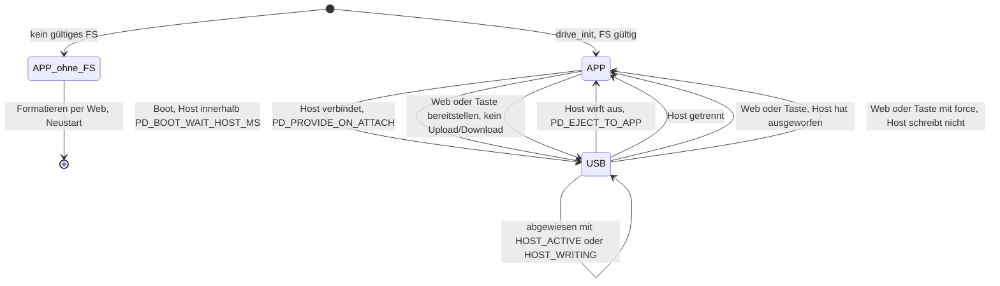

# 02 – Architektur

Beschreibt den Stand des Quellcodes in `firmware/` (WiFi DataDrive, Firmware 0.5.0). Die
Abschnitte 1 bis 8 stammen aus 0.2.0 und gelten unverändert, soweit nicht anders vermerkt.
Neu dazu kommen die Abschnitte 9 bis 11 (Anmeldung, Verschlüsselung, WLAN-Suche) mit ihrem
Prüfstand und Abschnitt 12 (Neuerungen von 0.5.0). Auf echter Hardware verifiziert sind USB-Laufwerk, Auswurf/Bereitstellen,
Download-Modus, Web-API und microSD unter Windows; offen sind Nur-Lese-Modus und der
Drucker (siehe [03_umsetzungsplan.md](03_umsetzungsplan.md)).

Das Projekt hieß bis Version 0.1.0 „WiFi PrintDrive“. Interne Namen bleiben: Ordner
`firmware/printdrive`, Header `X-PrintDrive`, Code-Präfix `pd_`/`PD_`. Die Weboberfläche
nennt den USB-Host „USB-Gerät“, den Besitzer `USB` „USB-Laufwerk aktiv“ und den Besitzer
`APP` „Dateiverwaltung aktiv“; Code, Log und dieses Dokument verwenden weiter Host,
bereitgestellt und Upload-Modus.

## 1. Module

| Modul | Ort | Aufgabe |
|---|---|---|
| `board` | `components/board` | Pins (`board.h`), APA102-LED (Bit-Banging), BOOT-Taste, Flash-Größe, Neustart in den ROM-Download-Modus (USB-PHY zurück an USB-Serial/JTAG, dann `RTC_CNTL_FORCE_DOWNLOAD_BOOT`) |
| `st7735` | `components/st7735` | `esp_lcd`-Paneltreiber (LILYGO, MIT) |
| `display` | `components/display` | RAM-Framebuffer 160×80 RGB565, 5×7-Font (ASCII + Umlaute), `display_flush()` per DMA |
| `pd_wifi` | `components/pd_wifi` | STA, Setup-AP, Reconnect mit Backoff (2–30 s), mDNS |
| `applog` | `components/applog` | hängt sich in `esp_log`, 8-KB-Ringpuffer für `/api/log`, optionaler Sink (CDC) |
| `drive` | `printdrive/main/drive.c` | Medienwahl (microSD/Flash), **Besitzer-Verwaltung** des Dateisystems, Formatieren, Dateioperationen, Upload-Pipeline |
| `usb_dev` | `printdrive/main/usb_dev.c` | TinyUSB-Installation, Konfigurationsdeskriptor, CDC-Log-Port, 1200-Baud-Touch, Soft-Re-Plug, Barrier |
| `web_server` | `printdrive/main/web_server.c` | HTTP-API ([07_api.md](07_api.md)) und eingebettete Weboberfläche (`web/index.html`, beim Bauen gzip-komprimiert) |
| `ui` | `printdrive/main/ui.c` | LCD-Statusbild, LED-Farbe, BOOT-Taste, QR-Code-Anzeige (seit 0.3.0), Anzeige „LIO“ (`anim.c`, seit 0.4.0) |
| `pd_crypt` | `components/pd_crypt` | Verschlüsselungsschicht zwischen Speichermedium und Dateisystem/USB (seit 0.4.0, Abschnitt 10) |
| `auth`, `web_auth` | `printdrive/main/auth.c`, `web_auth.c` | Benutzer, Sitzungen, vertraute Geräte, Anmeldesperre (seit 0.3.0, Abschnitt 9) |
| `web_files`, `web_wifi`, `web_system`, `web_crypt`, `web_ota` | `printdrive/main/web_*.c` | Endpunkte je Bereich (Dateien/Ordner, WLAN inkl. Suche, System, Verschlüsselung, Update); seit 0.3.0 |
| `ota` | `printdrive/main/ota.c` | Firmware-Update über die Weboberfläche, Rückkehr zur alten Version (seit 0.3.0) |
| `tls`, `web_static` | `printdrive/main/tls.c`, `web_static.c` | HTTPS-Option (seit 0.4.0; in 0.4.0 im Build abgeschaltet, seit 0.5.0 im Build mit Schalter, Voreinstellung aus); statische Auslieferung |
| `web_dav` | `printdrive/main/web_dav.c` | Netzlaufwerk (WebDAV) unter `/dav/` (seit 0.5.0, Abschnitt 12) |
| `web_zip` | `printdrive/main/web_zip.c` | Ordner als ZIP herunterladen (seit 0.5.0) |
| `pd_time` | `components/pd_time` | Uhrzeit per NTP, Zeitzone (seit 0.5.0) |
| `pd_dns` | `components/pd_wifi/pd_dns.c` | kleiner DNS-Dienst für die Einrichtungsseite am Setup-AP (seit 0.5.0) |

Startreihenfolge (`app_main.c`): `applog_init` → NVS (bei veraltetem Format nur NVS
löschen) → `board_init` → `ui_init` (BOOT-Bild) → `drive_init` (Speicher + USB; bei
Fehler: LCD `FEHLER` „Speicher/USB Init“, Abbruch ohne WLAN/Web) → `pd_wifi_start` →
`web_server_start` → `ui_start`.

## 2. Speicher und Flash-Layout

`firmware/partitions.csv` (gemeinsam für Smoke-Test und Hauptfirmware):

| Name | Typ | Offset | Größe | Zweck |
|---|---|---|---|---|
| nvs | data/nvs | 0x9000 | 0x5000 (20 KB) | WLAN-Daten, Flags |
| otadata | data/ota | 0xE000 | 0x2000 | OTA-Auswahl |
| ota_0 | app | 0x10000 | 0x280000 (2,5 MB) | Firmware |
| ota_1 | app | 0x290000 | 0x280000 (2,5 MB) | Reserve für spätere OTA |
| storage | data/fat | 0x510000 | 0xAF0000 (10,94 MiB) | Dateispeicher, endet genau bei 16 MiB |

Das Layout ist von Anfang an OTA-fähig, damit ein späteres OTA keine
Neupartitionierung (= Verlust der Dateien) erfordert.

### Medienwahl (`drive_init`)

Beim Start probiert `sd_try_init()` den microSD-Slot (SDMMC 4 Bit, bis 40 MHz
`SDMMC_FREQ_HIGHSPEED`, Pins aus `board.h`, interne Pull-ups zusätzlich). Antwortet eine
Karte, ist sie das Medium (`microSD card '<name>': <n> MB, <f> kHz, <b>-bit`); sonst
`no usable microSD card (<err>) - using internal flash` und die Partition `storage` wird
genutzt. Abschaltbar mit `CONFIG_PD_USE_SDCARD=n`. Das Medium gilt bis zum nächsten
Neustart: **kein Hot-Swap**, der Slot sitzt am USB-Stecker, Karte nur bei ausgestecktem
Dongle wechseln. `/api/status` meldet das Medium in `medium{sd,name}` (Name aus der CID
bzw. `Flash`), das LCD zeigt in der Speicherzeile `SD` statt `Frei`.

### Interner Flash

Dateisystem-Stapel: Partition → **Wear Levelling** (512-B-Sektoren, SAFE-Modus,
`sdkconfig.defaults`) → FAT. Die Firmware formatiert selbst mit MBR, Clustergröße
`CONFIG_PD_FAT_CLUSTER_KB` (Default **4 KiB → FAT12**; 2 KiB → FAT16, aber langsam),
Label `DATADRIVE` (vor 0.2.0 formatierte Volumes behalten `PRINTDRIVE`). Der USB-Host sieht
dieselben 512-B-Sektoren. `f_mkfs` mit
`MKFS_PARM.align = 8` Sektoren: Die MBR-Partition beginnt zwar bei Sektor 63, der
Datenbereich liegt aber auf 4-KiB-Grenzen der Flash-Löschsektoren (ohne das: 12 statt
47 KB/s beim Schreiben über USB, siehe [06_risiken.md](06_risiken.md)).

Warum 4-KiB-Cluster: FatFs schreibt bei Web-Uploads höchstens einen Cluster pro
Disk-Schreibzugriff. Ein 2-KiB-Cluster ist immer ein halber 4-KiB-Flash-Sektor, das Wear
Levelling muss jedes Mal lesen, löschen und neu schreiben. Gemessen: Web-Upload 7 KB/s mit
2-KiB-, **46 KB/s** mit 4-KiB-Clustern. Die Einstellung wirkt nur beim (Neu-)Formatieren.

### microSD

Die Karte wird direkt (ohne Wear Levelling) per SDMMC an FatFs und esp_tinyusb
(`tinyusb_msc_new_storage_sdmmc`) gegeben, der Host sieht ihre Sektoren. Formatieren per
Web erzeugt **FAT32** (FatFs wählt die Clustergröße) mit Datenbereich auf
4-MiB-Grenzen (`align = 8192` Sektoren, wie der SD-Formatter), Label `DATADRIVE`.
ESP-IDF-FatFs kann **kein exFAT**: exFAT-Karten (ab Werk meist > 32 GB) erscheinen als
„Kein Dateisystem!“ und müssen im Web auf FAT32 formatiert werden.

### Formatieren

`probe_and_format()` in `drive_init`, immer **vor** dem Start von USB:

- automatisch nur beim **ersten Start mit internem Flash**: kein gültiges FAT und NVS-Flag
  `fmt_done` fehlt; eine microSD-Karte wird **nie automatisch** formatiert;
- sonst nur auf Anforderung über die Weboberfläche: NVS-Flag `fmt_req` = Medium
  (1 = Flash, 2 = microSD) setzen → Neustart → Formatieren nur, wenn das beim Start
  gefundene Medium dazu passt. Danach wird `fmt_req` immer gelöscht – eine Anforderung
  für den Flash trifft also nie eine inzwischen eingelegte Karte und umgekehrt;
- ein vorhandenes, aber defektes Dateisystem wird **nie still neu formatiert**: LCD zeigt
  „Kein Dateisystem! / Im Web formatieren“, das Laufwerk wird auch dem Host nicht angeboten.

## 3. Besitzer-Zustandsautomat (Kern)

Das FAT hat immer genau einen Besitzer (`drive_owner_t`):

| Besitzer | Lokal (`/data`) | USB-Host |
|---|---|---|
| `APP` („Upload-Modus“, im Web „Dateiverwaltung aktiv“) | gemountet; Web darf listen, hochladen, herunterladen, umbenennen, löschen | sieht „kein Medium“ (wie leerer Kartenleser), jedes READ/WRITE wird abgewiesen |
| `USB` („bereitgestellt“, im Web „USB-Laufwerk aktiv“) | nicht gemountet, alle Dateioperationen → `WRONG_OWNER` | exklusiver Sektorzugriff |

Besitzer-Automat, Mechanismen und Umschaltregeln sind mit Version 0.2.0 unverändert.

### Mechanismen

1. **`auto_mount_off`**: esp_tinyusb schaltet nie selbst um. Der Automatik-Modus würde das
   FAT beim Anstecken eines Hosts unter einer offenen Upload-Datei aushängen.
2. **Host-I/O-Sperre** per Linker-`--wrap` (siehe `printdrive/main/CMakeLists.txt`) um
   `tud_msc_read10_cb`, `tud_msc_write10_cb`, `tud_msc_test_unit_ready_cb`:
   - solange APP besitzt: Sense `NOT READY / 0x3A` (MEDIUM NOT PRESENT) – auch für Hosts,
     die TEST UNIT READY ignorieren;
   - Host nur lesend: WRITE → Sense `DATA PROTECT / 0x27` (write protected);
     zusätzlich meldet `tud_msc_is_writable_cb` den Schreibschutz.
   Wrappen geht nur bei Callbacks ohne schwache Default-Implementierung in TinyUSB.
3. **Barrier**: Vor dem Mounten durch die App wird neue Host-I/O gesperrt und dann über
   `usbd_defer_func` eine Marke in die TinyUSB-Task gestellt (`usb_dev_barrier`, Timeout
   2 s). Erst wenn sie ankommt, sind alle bereits angenommenen, verzögert ausgeführten
   Host-Schreibzugriffe erledigt – esp_tinyusb 2.4.0 wartet darauf selbst nicht.
   Timeout → Log `USB barrier timeout - host writes may still be pending`, Umschaltung
   wird abgebrochen (`IO`).
4. **Medienwechsel**: Nach dem Bereitstellen meldet das erste TEST UNIT READY
   `UNIT ATTENTION / 0x28` („medium may have changed“), damit der Host seinen FAT-Cache
   verwirft.
5. **Soft-Re-Plug**: Beim Bereitstellen über Web/Taste wird zusätzlich `tud_disconnect()`
   → 600 ms → `tud_connect()` ausgeführt, wenn `CONFIG_PD_REPLUG_ON_PROVIDE` gesetzt ist
   (Default) oder der Host vorher ausgeworfen hatte (sonst schaut er nie wieder hin).
   Das dadurch ausgelöste DETACHED-Ereignis wird 4 s lang ignoriert. Beim Boot und beim
   Anstecken wird nicht re-plugged.
6. **Auswurf-Erkennung**: `tud_msc_scsi_complete_cb` wertet START STOP UNIT (0x1B) aus;
   `LOEJ && !START` = Auswerfen → Ereignis `EV_HOST_EJECT`.

### Umschaltregeln (`drive_set_owner`)

| Ziel | Bedingung | Ergebnis |
|---|---|---|
| beliebig | Upload aktiv oder Download offen | `BUSY` |
| USB | kein gültiges FS | `NO_FS` |
| USB | sonst | OK (+ Re-Plug wie oben) |
| APP | Host nicht verbunden oder hat ausgeworfen | OK |
| APP | Host hält das Laufwerk, darf schreiben und schrieb vor < `CONFIG_PD_HOST_WRITE_GUARD_MS` | `HOST_WRITING` – auch mit `force` |
| APP | Host hält das Laufwerk, ohne `force` | `HOST_ACTIVE` |
| APP | Host hält das Laufwerk, mit `force` | OK, Log `taking the drive from the host (confirmed by user)` |

Automatische Wechsel (Task `drive`): Boot-Politik – bis `CONFIG_PD_BOOT_WAIT_HOST_MS`
auf einen Host warten, dann bereitstellen (`host present at boot -> providing drive`),
sonst Upload-Modus (`no USB host at boot -> staying in upload mode`). Host-Anstecken →
bereitstellen (wenn nicht beschäftigt). Host getrennt oder Auswurf → APP.

Die Einstellung „Host darf schreiben“ (NVS `pd_drive/host_wr`, Default aus
`CONFIG_PD_HOST_WRITABLE_DEFAULT`) wirkt erst beim nächsten Bereitstellen.

## 4. Upload-Pipeline und Dateioperationen

1. Browser fragt `POST /api/upload/check` (Name, Größe, overwrite) – führt dieselben
   Prüfungen wie der echte Upload aus (begin + abort).
2. `POST /api/upload`: Rohdaten im Body (`application/octet-stream`), Länge = `Content-Length`;
   optional `mtime` und `now` (siehe „Zeitstempel“).
3. Prüfungen in `drive_upload_begin`: Name (`drive_check_name`: ≤ 120 Byte UTF-8, keine
   Steuerzeichen, kein `/\:*?"<>|`, nicht mit Punkt/Leerzeichen beginnend oder endend),
   Dateityp (Default `CONFIG_PD_UPLOAD_ALL_TYPES=y`: jeder; sonst nur `.3mf`, optional
   `.gcode`, andernfalls `415 BAD_TYPE`), Größe > 0 (sonst `INVALID_FILE`) und < 4 GiB
   (FAT-Grenze; die Größe wird 64-bittig gelesen, sonst `413 TOO_LARGE`), Zielname existiert
   nicht (oder overwrite), freier Platz ≥ Größe + 64 KB Reserve (die alte Datei wird erst
   nach Erfolg gelöscht).
4. Daten → Temp-Datei `/data/.pd_upload.tmp` (16-KB-Blöcke). Mehr Daten als angekündigt → `INVALID_FILE`.
5. Abschluss: Größe exakt, `fsync`; bei `.3mf` ZIP-Kopf `PK\3\4` und ZIP-End-of-Central-
   Directory `PK\5\6` in den letzten 1024 Byte; erst dann **umbenennen** (beim Überschreiben
   wird die alte Datei vorher in `/data/.pd_old.tmp` verschoben und erst danach gelöscht).
   Die ZIP-Prüfung gilt für `.3mf` auch dann, wenn alle Dateitypen erlaubt sind. Danach wird
   `mtime` gesetzt. Log `upload ok '<name>'` bzw. `upload failed '<name>': <Text>`.
6. Abbruch (Verbindung weg, 3 Timeouts à 10 s) → Temp-Datei gelöscht
   (`upload aborted '<name>' after <n> bytes`).
7. Liegengebliebene Temp-Dateien (Stromausfall) werden bei jedem Mounten durch die App
   gelöscht (`removing stale upload temp file (<n> bytes)`, `removing stale previous-version file …`).
8. Wird ein Upload schon vor oder während der Daten abgewiesen (z. B. `EXISTS`, `NO_SPACE`),
   liest der Server den restlichen Body und verwirft ihn (`drain_body`), damit der Client
   die Fehlerantwort erhält statt eines Verbindungsabbruchs (verifiziert: 409 `EXISTS`).

**Zeitstempel:** Das Gerät hat keine Uhr. Der Browser schickt `mtime` (Änderungsdatum der
Datei) und `now` (seine aktuelle Zeit), beide als Ortszeit-Sekunden seit 1970. `now` stellt
die Systemuhr, solange sie seit dem Start noch nicht gestellt wurde; `mtime` wird nach dem
Umbenennen per `utime()` auf die Datei geschrieben (Werte vor 1981 werden ignoriert). FAT
kennt keine Zeitzone, gespeichert ist also die Ortszeit des Schreibers.

**Dateiliste (`drive_list`):** nur normale Dateien im Wurzelverzeichnis, ohne Namen mit
führendem Punkt. Ordner werden nicht gelistet, nur gezählt (`dirs`, ohne
`System Volume Information`). Die Einträge stehen gepackt in einem 32-KiB-Puffer
(je 4 Byte Größe + 4 Byte `mtime` + Name + NUL, reicht für ca. 1000 übliche Namen; vorher
festes Feld mit 64 Einträgen), der pro Anfrage angelegt und wieder freigegeben wird. Passt
nicht alles hinein, wird gekürzt und `truncated` gemeldet. Die JSON-Antwort geht in
Stücken (chunked) raus.

**Umbenennen (`drive_rename`):** nur im Wurzelverzeichnis und nur bei Besitzer `APP`. Der
neue Name muss `drive_check_name` bestehen. `BUSY` während eines Up-/Downloads,
`NOT_FOUND`, wenn die Quelle keine normale Datei ist, `EXISTS`, wenn das Ziel vorhanden ist
(FatFs lehnt das selbst ab; reine Änderung der Groß-/Kleinschreibung ist erlaubt).

Ordner werden in der Weboberfläche nicht unterstützt (machbar, zurückgestellt).

Der ESP-IDF-HTTP-Server bearbeitet nur **eine Anfrage gleichzeitig**: Während eines Uploads
wird auch `/api/status` nicht beantwortet. Die Weboberfläche setzt ihr Status-Polling
während des Uploads aus (Fortschritt im Browser aus dem gesendeten Anteil); auf dem
Dongle zeigt das LCD den Fortschritt. Andere Clients warten bis zum Ende des Uploads.

## 5. WLAN (`pd_wifi`)

- **STA**: Zugangsdaten aus NVS (`pd_wifi/ssid`, `pass`, per Web gesetzt), sonst aus
  `firmware/pd_secrets.h` (`PD_WIFI_SSID`/`PD_WIFI_PASS`). NVS hat Vorrang. Energiesparen aus.
- **Setup-AP** `DataDrive-XXXX` (XXXX = letzte zwei Bytes der SoftAP-MAC), WPA2, Kanal 1,
  max. 3 Clients, `http://192.168.4.1`. Startet sofort, wenn keine Zugangsdaten vorhanden
  sind, sonst nach `CONFIG_PD_WIFI_AP_FALLBACK_S` (20 s) ohne Verbindung. Passwort:
  10 Zeichen, einmalig pro Gerät erzeugt, in NVS (`pd_wifi/ap_pass`), auf dem LCD angezeigt.
- AP geht `CONFIG_PD_WIFI_AP_LINGER_S` (120 s) nach erfolgreicher STA-Verbindung aus.
- Seit 0.3.0: bis zu 5 gespeicherte WLANs; verbunden wird mit dem stärksten bekannten. Die
  WLAN-Suche (seit 0.4.0) steht in Abschnitt 11.
- **mDNS**: `http://datadrive.local` (Hostname `CONFIG_PD_WIFI_HOSTNAME`, Default `datadrive`),
  Instanzname „WiFi DataDrive“, Dienst `_http._tcp`.

## 6. Weboberfläche und HTTP-API

### HTTP-API (Version 2)

Verbindlich beschrieben in [07_api.md](07_api.md) (Endpunkte, Parameter, Fehlercodes mit
HTTP-Status, Ablauf eines Uploads). Kurzfassung:

- Alle zustandsändernden Anfragen sind `POST` und brauchen den Header **`X-PrintDrive: 1`**
  (CSRF-Schutz), sonst `403 FORBIDDEN`. Seit 0.3.0 ist eine Anmeldung Pflicht (Abschnitt 9);
  der Stand 0.2.0 ohne Anmeldung ist überholt.
- Antwortformat: `{"ok":bool,"code":"…","error":"<deutscher Klartext>"}`; die Texte stammen
  aus `drive_result_str()`.
- Lesen: `/api/status`, `/api/files`, `/api/download`, `/api/log`. Ändern: `/api/mode`,
  `/api/upload/check`, `/api/upload`, `/api/delete`, `/api/rename`,
  `/api/settings/host_writable`, `/api/wifi`, `/api/format`, `/api/reboot`.
- Neu gegenüber Version 1: `/api/rename`; Upload-Parameter `mtime`/`now`; `/api/files`
  liefert `mtime`, `dirs` und `truncated`; `/api/status` meldet `types` (`"all"` oder Liste
  der Endungen) statt `allow_gcode`; Fehlertexte in einfacher Sprache.

### Weboberfläche (`web/index.html`)

Eine einzige HTML-Datei mit eingebettetem CSS und JavaScript, ohne Framework und ohne
externe Ressourcen. `main/CMakeLists.txt` komprimiert sie beim Bauen mit
`web/gzip_file.py` (reproduzierbar, ohne Zeitstempel) zu `index.html.gz` und bettet diese
ein; `h_index` liefert sie mit `Content-Encoding: gzip` aus. Gemessen: 60 KB roh → 19 KB in
Flash und Übertragung, Seitenaufruf vom Gerät 241 ms, freier Heap unverändert ca. 142 KB,
App-Binary 1,06 MB (60 % der App-Partition frei).

| Bereich | Inhalt |
|---|---|
| Hauptansicht „Meine Dateien“ | Statusleiste (Modus mit Umschaltknopf, Speicherbelegung), Dateiliste mit Typ-Symbol, Größe, Änderungsdatum, Suche, Sortierung (Spaltenköpfe am PC, Auswahlfeld am Handy) |
| Aktionsmenü je Datei | Herunterladen, Umbenennen, Löschen; Kontextmenü am PC, Bottom Sheet am Handy |
| Hochladen | Knopf oder Drag & Drop, Warteschlange mit Fortschritt und Abbrechen |
| Zustände | leer, gesperrt (USB-Laufwerk aktiv), Fehler (Speicher nicht lesbar, keine Antwort vom Gerät), Neustart |
| Einstellungen | Abschnitte Netzwerk, Speicher & USB, Sicherheit, System; getrennt „Gefahrenbereich“ mit Formatieren (getippte Bestätigung `LÖSCHEN`) und Wartungsmodus (Flash-Modus) |
| Darstellung | hell/dunkel, automatisch oder fest; flaches Symbol (WLAN-Bögen über einem Laufwerk) |

Verhalten:

- Benennungen: „USB-Laufwerk aktiv“ (Besitzer `USB`) und „Dateiverwaltung aktiv“ (`APP`),
  Aktionen „Dateiverwaltung aktivieren“ und „USB-Laufwerk bereitstellen“, der Host heißt
  „USB-Gerät“.
- Bei `HOST_ACTIVE` fragt ein Dialog nach („Laufwerk vom USB-Gerät trennen?“), erst dann
  folgt `force=1`. `HOST_WRITING` ist nie erzwingbar.
- Erfolgsmeldungen erscheinen erst, nachdem das Gerät bestätigt hat (Upload: 100 % heißt
  nur „gesendet“, „Gespeichert“ erst nach `ok:true`).
- „Nach dem Hochladen wieder bereitstellen“ (Standard an): Nur wenn der Upload selbst dem
  USB-Gerät das Laufwerk genommen hat, wird es danach zurückgegeben.
- Je Browser gespeichert (`localStorage`): Darstellung und „Nach dem Hochladen wieder
  bereitstellen“. Alles andere liegt auf dem Gerät.
- Status-Polling alle 3 s, ausgesetzt während eigener Uploads und bei verdecktem Tab; die
  Dateiliste wird nur neu geladen, wenn sich Besitzer, Dateizahl oder freier Platz ändern.
- Formatieren sendet nach der getippten Bestätigung `confirm=FORMAT` an `/api/format`.
- Die Ordnerbedienung (anlegen, verschieben, kopieren, Mehrfachauswahl, Zwischenablage) ist seit
  0.3.0 dabei. Ob der Hinweis auf ausgeblendete Ordner (`dirs`) danach noch nötig ist, ist
  **noch nicht geprüft**. Bei `truncated` erscheint ein Hinweis, dass nur ein Teil der Dateien
  gezeigt wird.
- Seit 0.3.0 zweisprachig (Deutsch/Englisch), mit Anmeldung und Passwortwechsel, und
  mit einem Abschnitt „Verschlüsselung“ unter Speicher & USB (seit 0.4.0).

Entwicklung ohne Hardware: `tools/mock_server.py` bildet die API nach, siehe
[04_build_und_flash.md](04_build_und_flash.md) Abschnitt 11.

## 7. LCD, LED, BOOT-Taste (`ui`)

Aufbau 160×80: Kopfzeile (Zustand, rechts `WLAN`/`AP`/`----`), Zeile 1 IP oder AP-SSID,
Zeile 2 `datadrive.local` oder `PW <AP-Passwort>`, Speicherzeile `Frei x / y` (microSD:
`SD x / y`) mit Balken (rot unter 10 % frei), Host-/Uploadzeile, Meldungszeile (6 s) bzw. `<n> Datei(en)`.

| Kopfzeile | Bedingung | Farbe (auch LED, gedimmt) |
|---|---|---|
| `BOOT` | während des Starts | grau (LED weißlich) |
| `FEHLER` | kein Besitzer oder FS unbrauchbar | rot |
| `UPLOAD` | Upload läuft (Prozent + Name) | orange |
| `USB` | Laufwerk am Host bereitgestellt | grün |
| `WLAN` | Upload-Modus, nicht verbunden, Setup-AP aktiv | cyan |
| `BEREIT` | Upload-Modus, sonst | blau |
| `FLASH` | BOOT 5 s gehalten, Neustart in Download-Modus | rot |

Host-Zeile (seit 0.2.0 „Gerät“ statt „Host“): `Kein USB-Gerät`, `Gerät: kein Laufwerk`,
`Gerät: ausgeworfen`, `Gerät schreibt...`/`Gerät liest...` (letzter Zugriff jünger als
`CONFIG_PD_HOST_WRITE_GUARD_MS`, Default 3 s), `Gerät: Standby`, `Gerät: verbunden`,
`Gerät: nur lesen`.

BOOT-Taste (alle 50 ms abgefragt):

- **kurz**: Umschalten USB ↔ Upload-Modus (`USB bereitgestellt` bzw. `Upload-Modus`). Hat der
  Host nicht ausgeworfen → `Gerät aktiv! Nochmal=OK`; ein zweiter Druck innerhalb von 4 s
  erzwingt (`force`). Weitere Meldungen: `Gerät schreibt - warten`, `Up-/Download läuft`,
  `Umschalten fehlgeschl.`
- **5 s halten**: Neustart in den ROM-Download-Modus (zum Flashen). Zurück: aus- und einstecken.

## 8. USB-Zusammensetzung

| Element | Wert |
|---|---|
| Interfaces | CDC-ACM (Log-Port) + MSC; CDC abschaltbar (`CONFIG_TINYUSB_CDC_ENABLED`) |
| VID/PID | Espressif `303A`, PID automatisch von esp_tinyusb: `4003` mit CDC, `4002` ohne |
| Konfigurationsdeskriptor | eigener, **500 mA**, kein Remote Wakeup |
| Strings | Hersteller „WiFi DataDrive“, Produkt „DataDrive“, Seriennummer = Chip-MAC (leerer Kconfig-String), CDC „DataDrive Log“, MSC „DataDrive Disk“ |
| SCSI INQUIRY | Vendor `DataDrv`, Product `WiFi DataDrive`, Rev `0.1` (im Code fest, nicht an die Firmware-Version gekoppelt) |
| Geschwindigkeit | Full Speed (12 Mbit/s brutto) |
| MSC-Puffer | 8192 B (`CONFIG_TINYUSB_MSC_BUFSIZE`) |

CDC-Log-Port: Log-Ausgaben gehen nur raus, solange DTR gesetzt ist. Beim Setzen von DTR
(Terminal öffnet den Port) wird zuerst der `applog`-Ringpuffer (8 KB, inkl. Start)
nachgeliefert, danach läuft das Log live weiter. Wird der Port mit
**1200 Baud** geöffnet und DTR fallen gelassen, startet der Dongle in den Download-Modus
(„1200-Baud-Touch“, genutzt von `tools/flash.ps1`). Eingaben werden ignoriert.

Konsole der Hauptfirmware: UART0 (GPIO43/44). Logs zusätzlich über CDC und `/api/log`.
Vor einem Neustart trennt ein Shutdown-Handler USB sauber (`tud_disconnect`, 50 ms).

## 9. Anmeldung und Benutzer (seit 0.3.0)

Prüfstand: API-Test am Gerät 182/182 (0.3.0). Die Regeln und Endpunkte stehen in
[09_api_v3.md](09_api_v3.md) Abschnitt 2; hier nur der Aufbau.

- **Zwei Wege:** Browser mit Sitzungs-Cookie (`dd_session`, im Arbeitsspeicher, 12 Stunden
  ohne Anfrage) oder HTTP Basic für Skripte und Kurzbefehle. Ohne Anmeldung sind nur
  Startseite, Icons, Sitzungsabfrage und Anmeldung erreichbar.
- **Benutzer:** höchstens 8, Rollen `admin` und `user`. Gespeichert werden Name, Rolle, Salz
  und ein PBKDF2-HMAC-SHA256-Wert (2000 Runden, 32 Byte) im Einstellungsspeicher, nie das
  Klartext-Passwort. Ohne Benutzer (erster Start, Reset per Taste) entsteht `admin` / `admin`.
- **Vertraute Geräte:** Die Sitzung kann dauerhaft gespeichert werden. Im Speicher liegt nur
  der SHA-256-Wert des Sitzungsschlüssels. Höchstens 4 je Benutzer, insgesamt 8.
- **Anmeldesperre:** je Adresse nach 5 Fehlversuchen, Wartezeit 30 s, dann doppelt, höchstens
  900 s. Dazu eine Gesamtgrenze gegen verteiltes Raten. Zähler und Sperren liegen im
  Arbeitsspeicher und enden mit dem Neustart.
- **Benutzerdatenbank nicht lesbar:** Das Gerät verweigert jede Anmeldung (`503
  AUTH_UNAVAILABLE`) und verlangt den Reset per Taste (10 s). Es wird nicht stillschweigend
  neu angelegt.
- **Erzwungener Passwortwechsel:** Solange das Auslieferungspasswort gilt, sind nur Anmeldung
  und Passwortwechsel erreichbar.

## 10. Verschlüsselungsschicht `pd_crypt` (seit 0.4.0)

Prüfstand: verifiziert am Gerät (API-Lauf 334/334 mit `--crypt-test`, Selbsttest beim Start).
Die Anwender-Sicht steht in [12_api_v4.md](12_api_v4.md) Abschnitt 2, die Grenzen des
Schutzes in Abschnitt 2.5.

- **Lage:** Zwischen Speichermedium (microSD oder interner Flash) und allem darüber (FatFs,
  USB-Massenspeicher). Die Besitzer-Logik aus Abschnitt 3 bleibt darüber unverändert.
- **Verfahren:** AES-256-XTS, 512-Byte-Sektoren, die Sektornummer dient als Tweak. Die
  Verschlüsselung läuft in der AES-Hardware des ESP32-S3; ein Selbsttest mit den
  IEEE-1619-Prüfwerten prüft beide Wege (Hardware und Bibliothek) beim Start.
- **Schlüssel:** ein zufälliger 512-Bit-Hauptschlüssel verschlüsselt die Daten. Er liegt zweimal
  im Kopfbereich verpackt: einmal mit einem Schlüssel aus dem Laufwerks-Passwort
  (PBKDF2-HMAC-SHA256; die Rundenzahl wird so gewählt, dass eine Ableitung
  `CONFIG_PD_CRYPT_KDF_TARGET_MS`, Standard 2 s, dauert), einmal mit einem Schlüssel aus dem
  Wiederherstellungsschlüssel. Im Speicher liegt der Hauptschlüssel nur, solange das Laufwerk
  entsperrt ist.
- **Layout:** Sektor 0 Kopfbereich, letzter Sektor Sicherungskopie, dazwischen ein Abstand
  (auf der microSD 4 MiB), danach die verschlüsselten Daten. Kopf- und Sicherungsdaten tragen
  je eine Prüfsumme (SHA-256) und eine Generationsnummer. Beim Schreiben des Kopfes wird zuerst
  die Sicherung geschrieben, dann das Original.
- **Einrichten:** löscht zuerst das ganze Medium (SD-Befehl ERASE). Lässt die Karte das nicht
  zu, werden die Sektoren überschrieben, bis zu `CONFIG_PD_CRYPT_OVERWRITE_MAX_MB` (Standard
  64 MB); darüber wird das Einrichten verweigert.
- **Passwortwechsel:** schreibt nur den Kopfbereich neu; die Daten bleiben unberührt.
- **Zustände:** unverschlüsselt, entsperrt, gesperrt, beschädigt (Schlüsselbereich unlesbar).
  Gesperrt heißt: kein Medium für den Host, keine Dateioperation der Firmware. Die Tabelle steht
  in [12](12_api_v4.md) Abschnitt 2.1.
- **Geschwindigkeit:** Der Schreibpfad nutzt einen Puffer von 8 KiB (Standard), der nur
  während des Entsperrens belegt ist. Gemessene Werte: [01](01_bestandsaufnahme.md) Abschnitt 7
  und [05](05_testprotokoll.md) Phase 8.

## 11. WLAN-Suche (seit 0.4.0)

Prüfstand: verifiziert bei bestehender WLAN-Verbindung (5 Netze in 2,9 s). Im
Einrichtungsmodus (Handy am Zugangspunkt des Sticks) **noch nicht geprüft**.

- Endpunkt `GET /api/wifi/scan` (Rolle `admin`), Antwort in [12](12_api_v4.md) Abschnitt 1.
- Die Suche dauert 2 bis 3 s und blockiert wie jede Anfrage; es läuft immer nur eine.
- Sie ändert weder die gespeicherten Netze noch die bestehende Verbindung.

## 12. Neuerungen von 0.5.0

Schnittstelle: [15](15_api_v5.md). Prüfstand: [05](05_testprotokoll.md) Phase 9 (API-Test am
Gerät 354/354). Die Beschreibung folgt dem Quelltext und den Kommentaren darin.

- **Netzlaufwerk (`web_dav.c`):** WebDAV unter `/dav/`, nur HTTP-Basic-Anmeldung. Greift nur
  über `drive.h` auf das Laufwerk zu, mit denselben Regeln wie die Dateiverwaltung (Pfadprüfung,
  Dateitypen, Upload über Temp-Datei). Arbeitet nur, solange die Firmware das Laufwerk besitzt;
  gehört es dem USB-Gerät, antwortet es `503` mit `Retry-After`. Es übernimmt das Laufwerk nie
  selbst, weil WebDAV-Programme lange Folgen von Anfragen schicken und das Medium sonst ständig
  zwischen Drucker und Firmware wechseln würde. Leere Dateien, die Windows zuerst anlegt, werden
  nur im Arbeitsspeicher vorgemerkt (höchstens 5 Minuten). Mit echten Programmen **noch nicht
  geprüft**.
- **Uhrzeit (`components/pd_time`):** NTP-Server aus dem DHCP des Routers, dazu `pool.ntp.org`.
  Zeitzone als POSIX-Zeichenkette (Voreinstellung Deutschland mit Sommerzeit); sie bestimmt die
  Ortszeit, die auf das FAT geschrieben wird. Ohne NTP stellt der Browser die Uhr. Verifiziert:
  Uhr nach dem Start gestellt.
- **Automatisches Sperren (`drive.c`):** Zeitablauf nur in der Dateiverwaltung (Untätigkeit von Web und WebDAV; im USB-Modus läuft keine Zeit),
  dazu auf Wunsch das Verschwinden des USB-Geräts; sperrt nie während eines Schreibvorgangs oder einer Übertragung.
  Wirkung wie das Sperren von Hand. Zeitablauf am Gerät **noch nicht geprüft**.
- **Upload fortsetzen (`drive.c`, `web_files.c`):** höchstens ein angefangener Upload; sein
  Stand liegt nur im Arbeitsspeicher, die Daten in der Temp-Datei. Verifiziert per API-Test.
- **ZIP (`web_zip.c`):** Methode „stored“, gestreamt mit `chunked`. Das zentrale Verzeichnis wird
  nicht im Speicher gehalten, sondern in einem weiteren Durchlauf neu erzeugt; im Speicher bleiben
  nur die CRC-Werte (4 Byte je Datei, höchstens 4096 Dateien). Während des ZIP gelten Besitzerwechsel,
  Formatieren, Sperren und Ordneraktionen als belegt (`BUSY`). Verifiziert per API-Test.
- **Einrichtungsseite (`pd_dns.c`, `web_server.c`):** Solange der Setup-AP läuft, beantwortet
  ein kleiner DNS-Dienst jeden Namen mit der Adresse des Sticks; der Webserver leitet die
  Prüfadressen der Betriebssysteme auf die Einrichtungsseite um. Kconfig:
  `CONFIG_PD_WIFI_CAPTIVE_PORTAL`. Mit echtem Handy **noch nicht geprüft**.
- **Display-Sprache (`ui.c`):** eine Einstellung für das Display, die die Weboberfläche beim
  Umstellen der Sprache mitschickt.
- **HTTPS (`tls.c`):** Der Stick ist seine eigene kleine Zertifizierungsstelle (ECDSA P-256,
  beschränkt auf den Gerätenamen, `*.local` und private IPv4-Adressen). Neu in 0.5.0: Die beiden
  TLS-Datensatzpuffer werden einmal beim Start reserviert und über einen eigenen Allokator an
  mbedTLS gegeben (`CONFIG_MBEDTLS_CUSTOM_MEM_ALLOC`); es gibt nur eine TLS-Verbindung
  gleichzeitig; die Dateiliste wird (auch über HTTP) ohne eigenen großen Puffer direkt gesendet,
  die Grenze für `truncated` bleibt laut Quelltext wie bisher. Messwerte:
  [05](05_testprotokoll.md) T9.11.
